<div align="center">

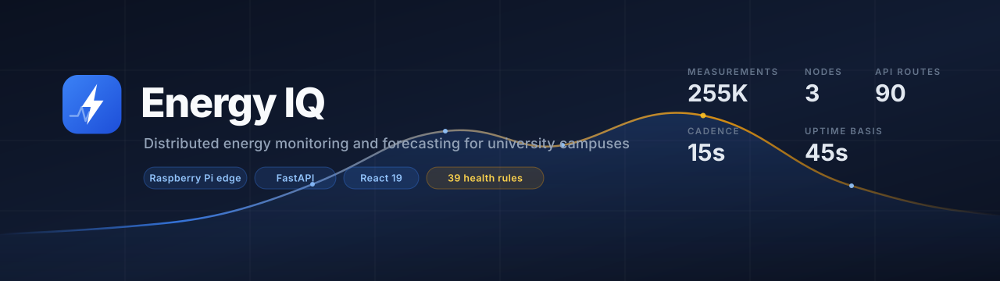

<br>

**Distributed energy monitoring, forecasting and alerting for university campuses.**

Raspberry Pi nodes measure electrical load at building panels, buffer locally, and
synchronise to a FastAPI backend that attributes, analyses, forecasts and watches itself.

<br>

[](https://www.python.org/)
[](https://fastapi.tiangolo.com/)
[](https://react.dev/)
[](https://www.typescriptlang.org/)
[](https://www.sqlite.org/wal.html)
[](https://www.raspberrypi.com/)
[](https://scikit-learn.org/)
[](https://systemd.io/)

[](https://github.com/dvaca0/energy-iot-platform/actions/workflows/backend.yml)
[](https://github.com/dvaca0/energy-iot-platform/actions/workflows/frontend.yml)
[](https://github.com/dvaca0/energy-iot-platform/actions/workflows/docs.yml)
[](https://github.com/dvaca0/energy-iot-platform/actions/workflows/security.yml)

[](LICENSE)
[](CHANGELOG.md)
[](https://github.com/dvaca0/energy-iot-platform/commits/main)
[](https://github.com/psf/black)
[](https://www.conventionalcommits.org/)

**[Documentation](docs/README.md)** ·
[Architecture](docs/Architecture.md) ·
[API](docs/API.md) ·
[Deployment](docs/Deployment.md) ·
[Hardware](docs/Hardware.md) ·
[Changelog](CHANGELOG.md)

</div>

---

## What this is

A production energy-monitoring platform running against real electrical
infrastructure at a Mexican university. It has been ingesting continuously since
May 2026.

<div align="center">

| | | | |
|:--:|:--:|:--:|:--:|
| **255,379** | **39** | **90** | **12** |
| measurements | health rules | API routes | migrations |
| **15 s** | **45 s** | **7 days** | **33** |
| sample cadence | heartbeat cadence | edge buffer | database tables |

<sub>Read from the running system on 2026-08-04. Every figure in this repository
is reproducible — the command is printed beside it in the docs.</sub>

</div>

<div align="center">
  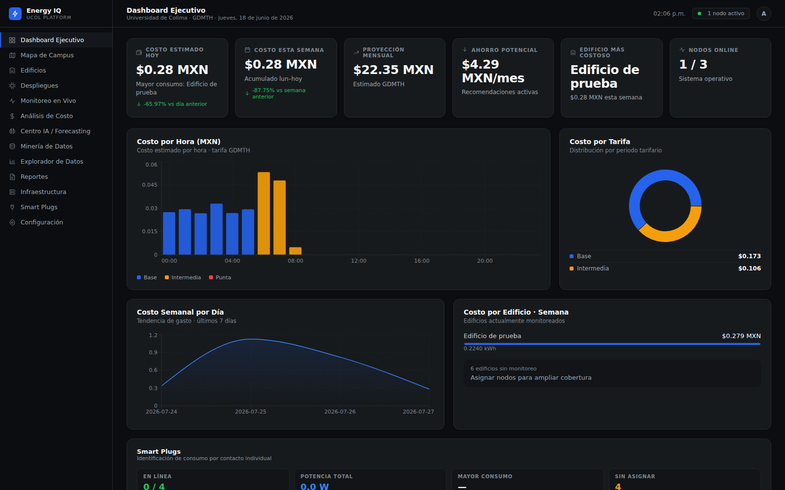
  <br><sub><b>Dashboard Ejecutivo</b> — live cost against the CFE GDMTH tariff, period breakdown, weekly trend</sub>
</div>

---

## The problem it solves

A campus receives one electricity bill. It does not tell you which building
caused it, which hour of the day was expensive, whether a fault is developing, or
what next week will cost.

This platform answers those questions by measuring at the panel, attributing
each reading to a building and an installation campaign, applying the real tariff
structure, and forecasting from the resulting series — while watching its own
hardware closely enough to know when a number should not be trusted.

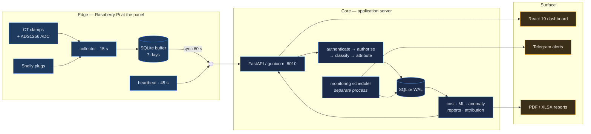

All 12 system diagrams: **[docs/diagrams/](docs/diagrams/README.md)**

---

## Features

<table>
<tr>
<td width="50%" valign="top">

### ⚡ Edge measurement
Raspberry Pi nodes sample at 15 s through a 24-bit ADS1256 and non-invasive CT
clamps. Each sample is committed to a **local buffer before any upload is
attempted**, so a backend outage delays data instead of losing it — up to seven
days.

</td>
<td width="50%" valign="top">

### 🔔 Monitoring that stays quiet
39 health rules with deployment gating, sustain windows, hysteresis and
report-only routing. Rebuilt after the first production run sent **1,386
Telegram messages in four days**. It now pages when a breaker is genuinely
exceeded, and stays silent otherwise.

</td>
</tr>
<tr>
<td valign="top">

### 🧠 Forecasting that admits uncertainty
RandomForest demand and cost forecasting, IsolationForest anomalies, KMeans
building profiles — all scikit-learn, all local. A model without enough history
reports `trained: false` **and the UI shows it** rather than inventing a number.

</td>
<td valign="top">

### 💰 Real tariff modelling
CFE **GDMTH** base / intermediate / peak periods with fixed charges, driven by a
scraper so published rates do not go stale. One cost engine backs the dashboard,
the PDF report and the monitoring rules.

</td>
</tr>
<tr>
<td valign="top">

### 🔌 Per-outlet sub-metering
Shelly Plug US Gen4 over Gen4 RPC as **accessories of a deployment**, never as
nodes — separate tables, separate buffer, so a plug reading can never be summed
into a panel total. Discovery runs on the Pi; the backend never scans a network.

</td>
<td valign="top">

### 🧭 Attribution that survives replay
Every reading resolves to the deployment active at **its own capture time**, not
the newest one. A node replaying seven days of buffer across a deployment change
still files each row against the right building.

</td>
</tr>
</table>

---

## Screens

<table>
<tr>
<td width="50%">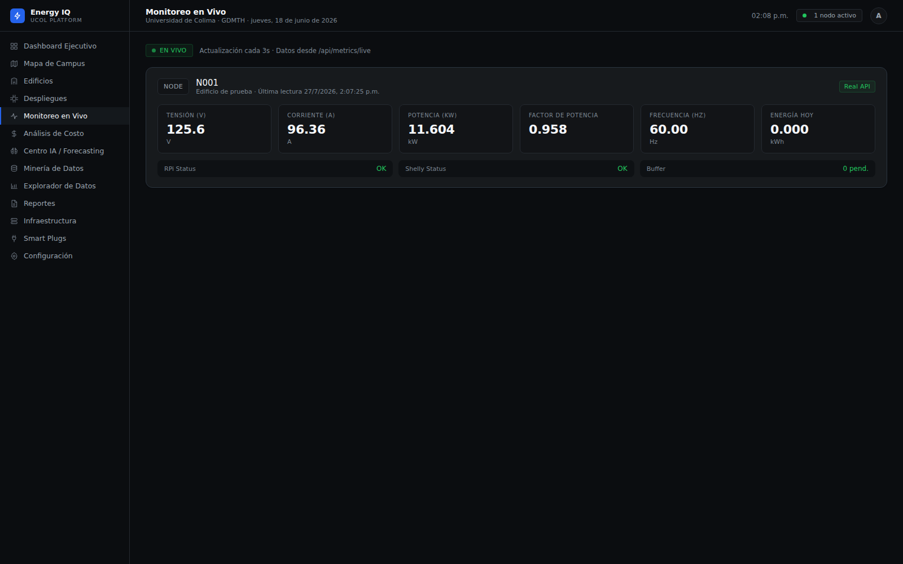<br><sub><b>Live monitoring</b> — V, A, kW, PF, Hz and buffer depth at 3 s</sub></td>
<td width="50%">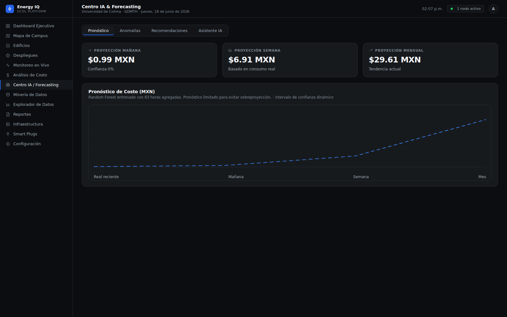<br><sub><b>AI centre</b> — forecast with an explicit confidence basis</sub></td>
</tr>
<tr>
<td>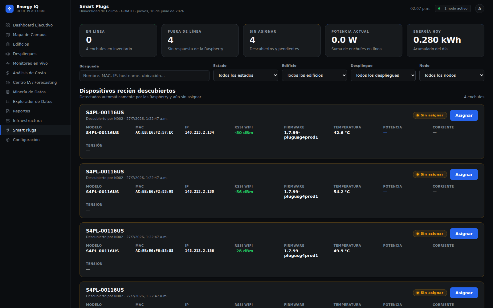<br><sub><b>Smart plugs</b> — fleet state and per-outlet power</sub></td>
<td>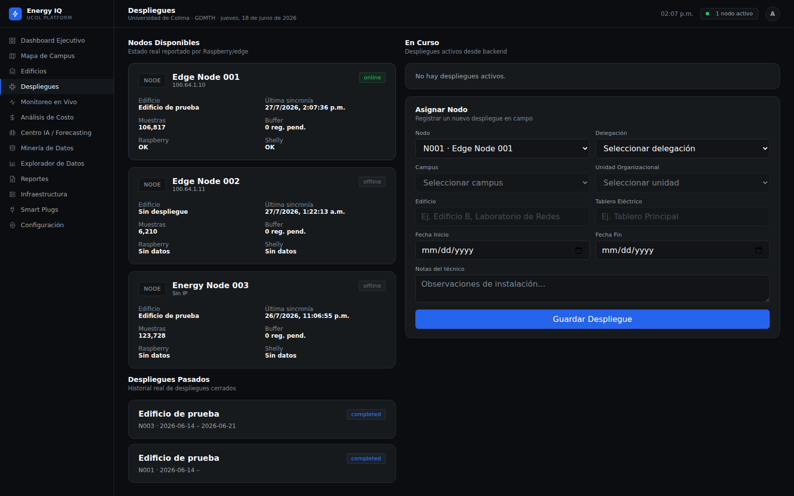<br><sub><b>Deployments</b> — installation campaigns and lifecycle</sub></td>
</tr>
<tr>
<td>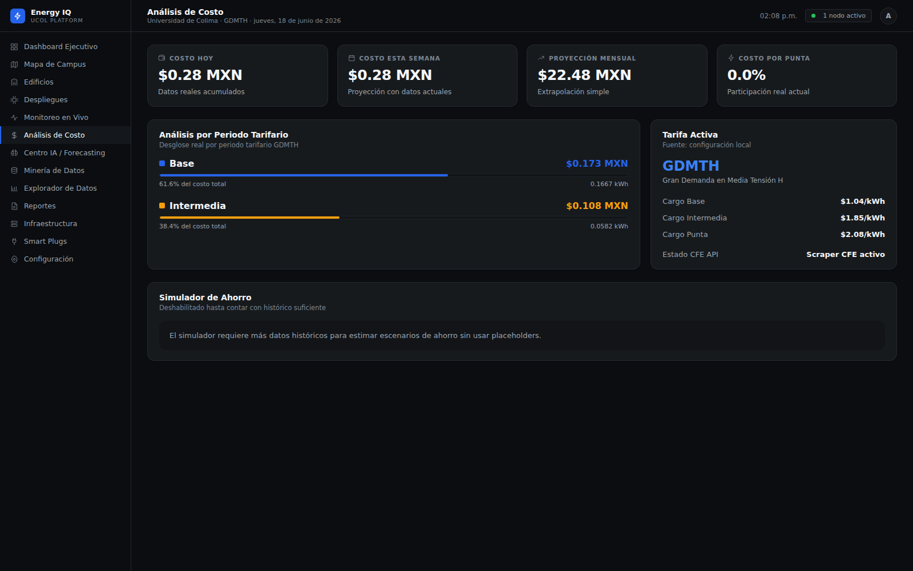<br><sub><b>Cost analysis</b> — GDMTH tariff-period breakdown</sub></td>
<td>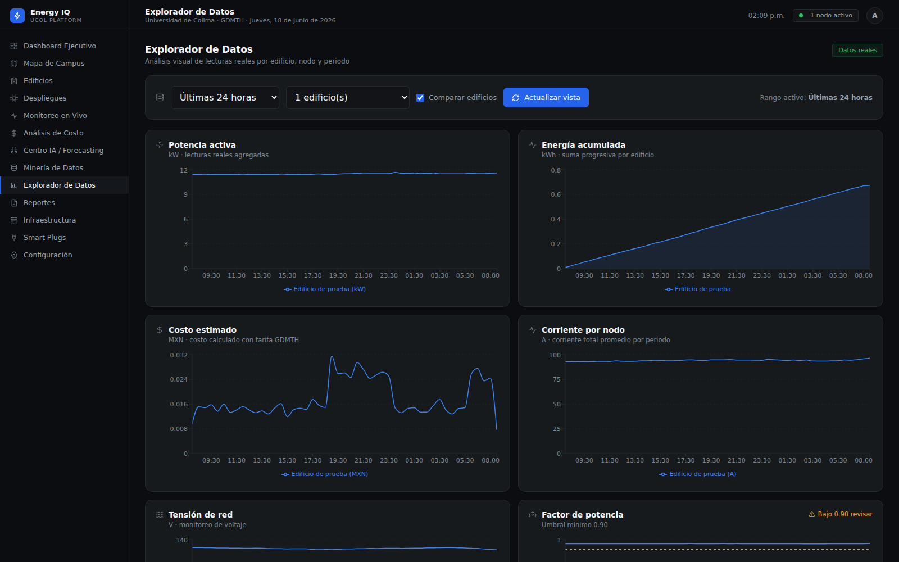<br><sub><b>Data explorer</b> — query the raw series directly</sub></td>
</tr>
</table>

<details>
<summary><b>Nine more screens</b> — infrastructure, campus map, buildings, data mining, reports, settings, login…</summary>
<br>
<table>
<tr>
<td width="33%">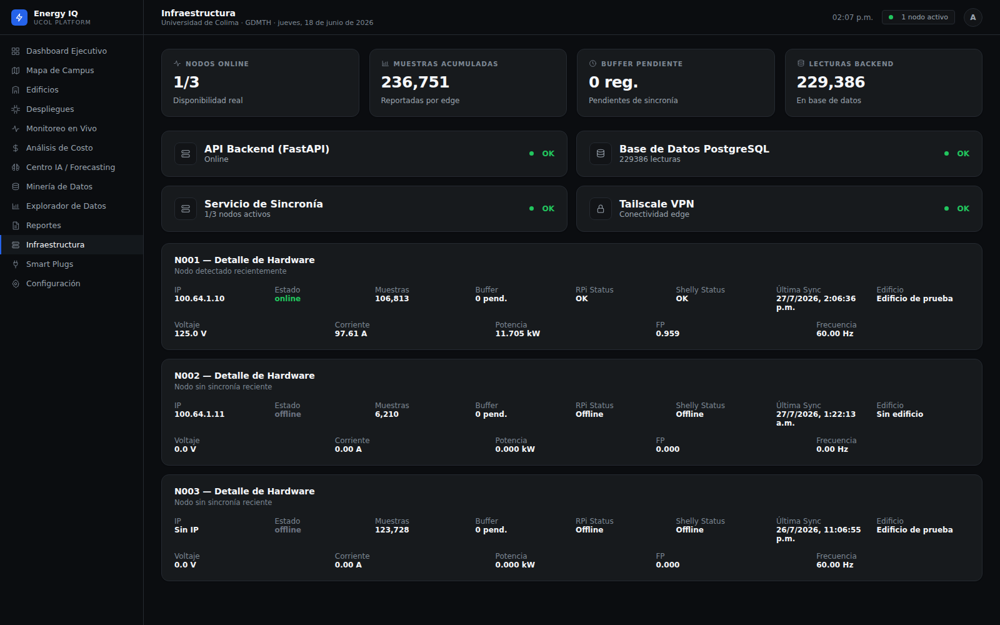<br><sub>Infrastructure</sub></td>
<td width="33%">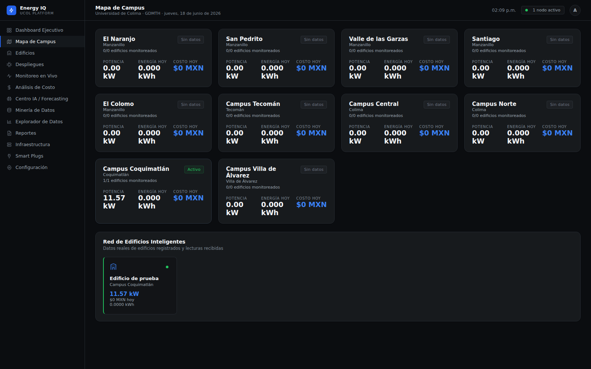<br><sub>Campus map</sub></td>
<td width="33%">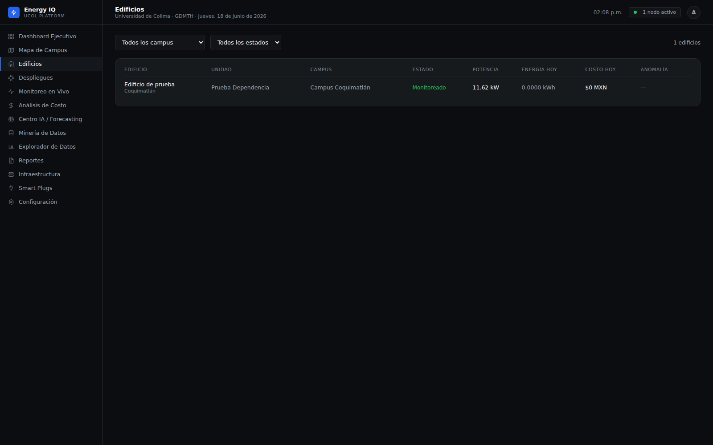<br><sub>Buildings</sub></td>
</tr>
<tr>
<td>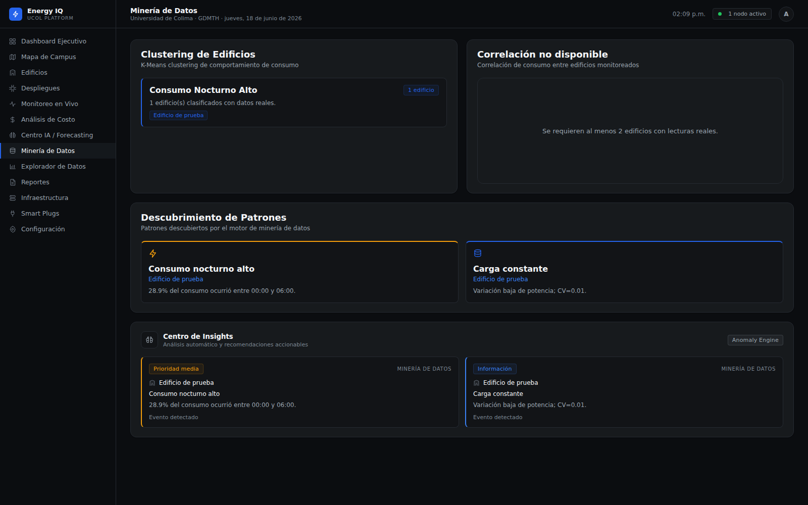<br><sub>Data mining</sub></td>
<td>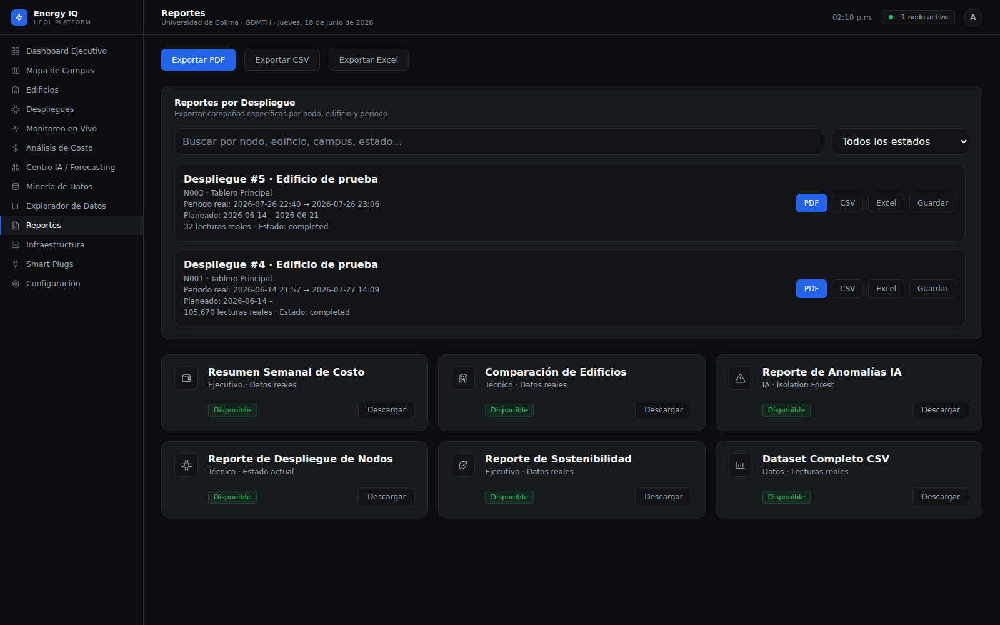<br><sub>Reports</sub></td>
<td>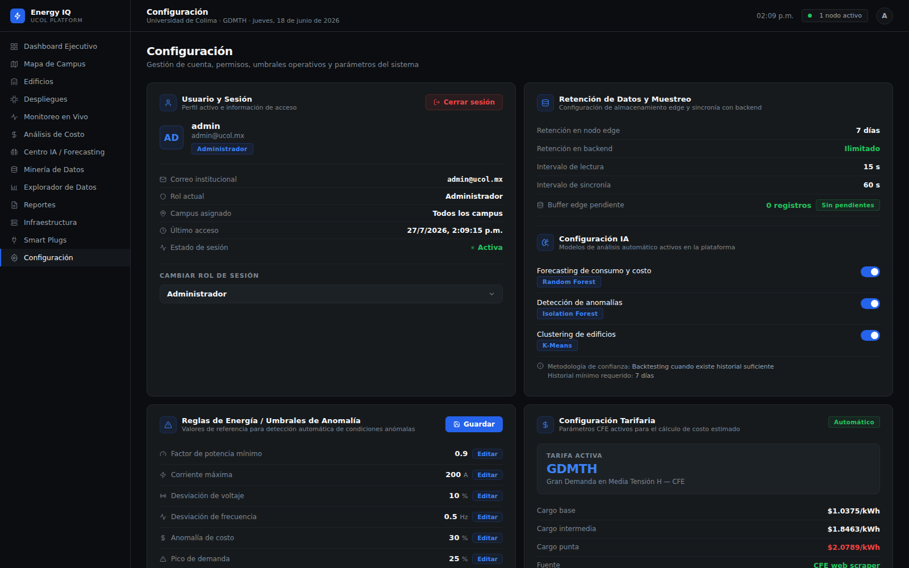<br><sub>Settings</sub></td>
</tr>
<tr>
<td>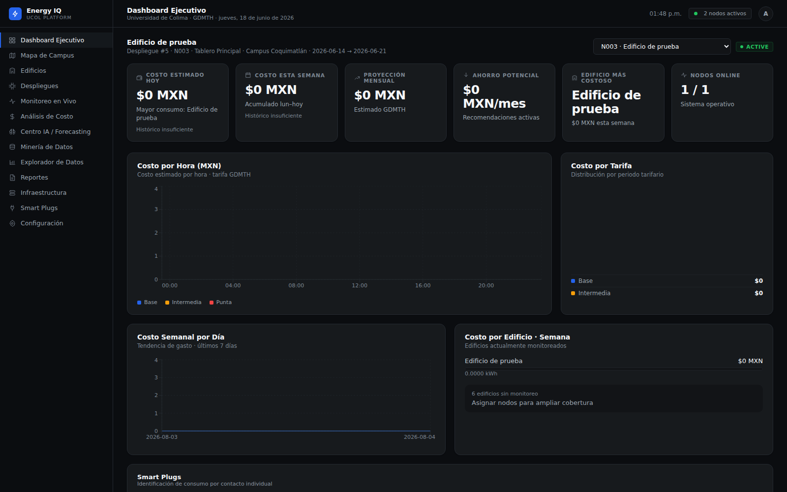<br><sub>Deployment selector</sub></td>
<td>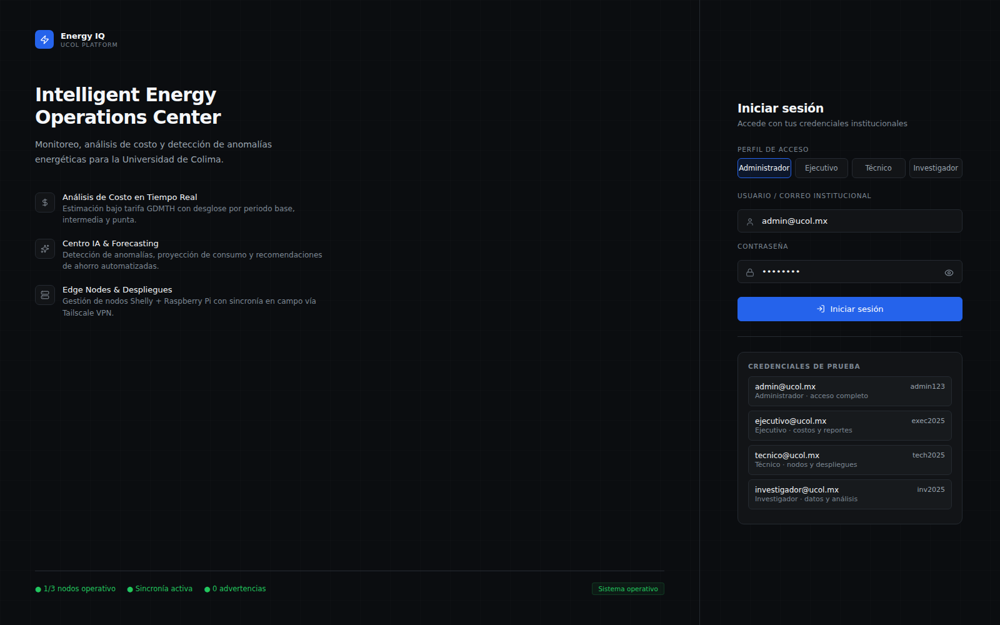<br><sub>Login</sub></td>
<td valign="middle"><sub>Full index and capture guidance in <a href="assets/screenshots/MANIFEST.md">the screenshot manifest</a>.</sub></td>
</tr>
</table>
</details>

> [!NOTE]
> The interface is **Spanish** — the users are Mexican university facilities
> staff and the tariff model is Mexican. The codebase, comments and
> documentation are English.

---

## Hardware

| Component | Role |
|---|---|
| **Raspberry Pi 3 B+ / 5** | Collector, local buffer, heartbeat agent. The fleet is deliberately mixed — the platform is built to tolerate that. |
| **ADS1256** | 24-bit delta-sigma ADC over SPI. Chosen because overnight base load and a single failing compressor are far down the range of a 300 A panel. |
| **CT clamps** | Split-core, non-invasive. No conductor is broken to install a node. |
| **Shelly Plug US Gen4** ×4 | Per-outlet sub-metering over Wi-Fi. |

Every connection is initiated **outbound from the node**, so a Pi behind ordinary
consumer NAT needs no network configuration. Details:
**[docs/Hardware.md](docs/Hardware.md)** · **[docs/Networking.md](docs/Networking.md)**

---

## Quick start

```bash
git clone https://github.com/dvaca0/energy-iot-platform.git
cd energy-iot-platform
```

**Backend**

```bash
cd backend
python3 -m venv venv && venv/bin/python3 -m pip install -r requirements.txt
cp .env.example .env                       # optional keys may stay blank
venv/bin/python3 -m migrations.runner --apply
venv/bin/python3 -m uvicorn app.main:app --reload --port 8010
```

**Frontend**

```bash
cd frontend && npm ci && npm run dev
```

**Get data in** — a fresh checkout has an empty database:

```bash
cd backend && venv/bin/python3 -m tests.test_synthetic_deployment
```

That drives the entire pipeline against a generated campaign including a real
overload. Full setup: **[docs/Development.md](docs/Development.md)**

> [!IMPORTANT]
> Always run the backend with `backend/` as the working directory. `.env`, the
> runtime settings and the database are resolved relative to it, and a wrong
> working directory fails **silently** — the platform starts with no credentials
> and no error.

---

## Testing

Six suites, written as plain-python assertions with no test framework, because
**pytest is not installed on the deployment host** and the tests must be runnable
there.

```bash
cd backend
for t in monitoring collector energy_aggregate smart_plugs synthetic_deployment; do
  venv/bin/python3 -m tests.test_$t
done
```

| Suite | Checks | In CI |
|---|--:|:--:|
| `test_monitoring` — rules, severity, thresholds, alert-noise guards | 329 | ✅ |
| `test_smart_plugs` — Shelly ingest, ownership, assignment | 53 | ✅ |
| `test_collector` — the measurement contract | 49 | ✅ |
| `test_synthetic_deployment` — the whole pipeline, real overload | 18 | ✅ |
| `test_energy_aggregate` — rollups and interval arithmetic | — | ✅ |
| `test_deployment_lifecycle` — transitions, exclusivity | — | ❌ |

`test_deployment_lifecycle` asserts against a **copy of the live production
database** and cannot run on a fresh checkout. That is a known gap, listed on the
roadmap rather than hidden behind a green badge.

> [!IMPORTANT]
> Sections 19–25 of `test_monitoring`, and `test_synthetic_deployment`, are
> **sensitivity checks**: they assert real faults still fire while known noise
> stays silent. A monitoring system that went quiet because it stopped looking is
> worse than one that is noisy — and these tests exist because that is exactly
> what nearly happened.

---

## Engineering record

Not a feature list — the decisions, and what they cost.

<table>
<tr><td width="30%"><b>The scheduler is a separate process</b></td>
<td>An in-process scheduler would multiply alerts the moment gunicorn moved off <code>-w 1</code>, and could not report a backend crash because it would die with it. The cost is a second unit to operate — which is why it monitors itself.</td></tr>

<tr><td><b>SQLite, in WAL mode, deliberately</b></td>
<td>One writer, many readers, 255k rows, no second process to operate. The constraint it imposes is real and documented: <code>cp</code> produces a <b>silently corrupt backup</b>, so backups use the online backup API.</td></tr>

<tr><td><b>No hardware logic in the backend</b></td>
<td>Adding a meter type is a collector change and at most one row in <code>measurement_eras</code> — never a change to the analytics layer. Enforced by <a href="backend/docs/collector-contract.md">the collector contract</a>.</td></tr>

<tr><td><b><code>energy_source</code> is mandatory</b></td>
<td><code>interval_energy_kwh: 0.0517</code> is unfalsifiable on its own. With it, a reader knows whether the number came from a meter or from arithmetic. The absence of exactly this field caused the incident that produced the contract.</td></tr>

<tr><td><b>Five concepts, five owners</b></td>
<td>Identity, health, lifecycle, attribution and semantics were once two columns. No owner reads another's state to answer its own question — see <a href="backend/docs/adr/0001-separate-identity-health-lifecycle-attribution.md">ADR-0001</a>.</td></tr>

<tr><td><b>Hand-rolled migrations</b></td>
<td>12 versions with explicit up/down SQL, shadow runs against a copy, and invariant checks. Alembic's autogeneration would not have caught that renaming a table carries its indexes under their old names — which collides mid-rebuild of a 255k-row table.</td></tr>
</table>

**Seven ADRs** record the reasoning: [`backend/docs/adr/`](backend/docs/adr/README.md)

---

## Documentation

| | | |
|---|---|---|
| [Architecture](docs/Architecture.md) | [Backend](docs/Backend.md) | [Frontend](docs/Frontend.md) |
| [Database](docs/Database.md) | [Collector](docs/Collector.md) | [Hardware](docs/Hardware.md) |
| [Monitoring](docs/Monitoring.md) | [AI & forecasting](docs/AI.md) | [Smart plugs](docs/Smart-Plugs.md) |
| [Deployment](docs/Deployment.md) | [Networking](docs/Networking.md) | [Security](docs/Security.md) |
| [Recovery](docs/Recovery.md) | [Troubleshooting](docs/Troubleshooting.md) | [Versioning](docs/Versioning.md) |
| [Development](docs/Development.md) | [API reference](docs/API.md) | [Diagrams](docs/diagrams/README.md) |

`docs/API.md` is generated from the running OpenAPI schema and **verified in CI**
— a route that exists but is undocumented fails the build.

---

## Known limitations

Stated plainly. A portfolio that hides these is not an engineering record.

| Limitation | Impact |
|---|---|
| **Ingestion endpoints are unauthenticated** | `device_id` is self-asserted. A forged heartbeat can suppress a real outage alert. Documented in [ADR-0002](backend/docs/adr/0002-upload-authorization.md); the top roadmap item. |
| **The base collector is not in this repository** | The ADS1256 sampling process is maintained on the devices. Its behaviour is fully specified by the collector contract, but its source of truth is a device rather than a repository. |
| **No frontend test suite** | The backend has six; the React app has none. |
| **Single application server** | No failover. A host loss stops ingestion; node buffers absorb up to seven days. |
| **Backups live on the application server** | A host loss takes them with it. |
| **`App.tsx` is ~2.4k lines** | Most screens are not extracted into modules; 36 ESLint findings are pre-existing. |
| **mypy is advisory** | 45 findings in `app/monitoring` alone. The codebase predates typing as a requirement. |
| **Two of three nodes are not on production loads** | N002 is standby by design; N003's July data is ADS1256 bring-up at the noise floor, correctly excluded from analytics by context. |

---

## Roadmap

Ordered by consequence, not by ease.

- [ ] **Authenticate the ingest path** — per-node shared secret or mTLS. Closes the one gap that can make monitoring lie.
- [ ] **Bring the base collector under version control.** The one component whose source of truth is a device.
- [ ] **Move backups off the application server.** The largest gap in durability.
- [ ] Make `test_deployment_lifecycle` hermetic so it can run in CI.
- [ ] Frontend test suite; extract screens out of `App.tsx`.
- [ ] Annotate `app/monitoring` and make mypy blocking for it.
- [ ] Weather as an exogenous forecasting feature — HVAC dominates campus load in Colima.
- [ ] Per-building models once more than one building is genuinely instrumented.
- [ ] A sourceable bill of materials with part numbers.
- [ ] Hardware photographs ([manifest](assets/screenshots/MANIFEST.md#hardware-photographs)).

---

## Research context

Built as applied research into campus-scale energy instrumentation: whether
low-cost edge hardware plus disciplined data modelling can produce measurements
trustworthy enough for operational and financial decisions.

The interesting result is not the dashboard. It is what the system does when it
is **uncertain** — refusing to forecast without sufficient history, classifying
bring-up data so it can never reach a model, resolving attribution by capture
time so a replayed buffer is not silently misfiled, and suppressing alerts for
equipment that is not operationally deployed.

Most of the engineering in this repository exists because a naive version of it
produced a confident wrong answer first.

---

## Contributing

Issues and pull requests are welcome. Start with
**[CONTRIBUTING.md](CONTRIBUTING.md)** — it documents five rules that are not
negotiable, each of which exists because breaking it caused a production
incident.

Security issues: **do not open a public issue**. See
[SECURITY.md](SECURITY.md).

---

## Credits

| | |
|---|---|
| **Author** | [@dvaca0](https://github.com/dvaca0) |
| **Context** | Universidad de Colima — campus energy instrumentation |
| **Built with** | [FastAPI](https://fastapi.tiangolo.com/) · [SQLAlchemy](https://www.sqlalchemy.org/) · [scikit-learn](https://scikit-learn.org/) · [React](https://react.dev/) · [Vite](https://vite.dev/) · [Recharts](https://recharts.org/) · [WeasyPrint](https://weasyprint.org/) |
| **Tariff data** | [Comisión Federal de Electricidad](https://app.cfe.mx/) (GDMTH) |

Institutional logos and names are used to identify the deployment context. They
do not imply endorsement.

---

## License

[MIT](LICENSE) © 2026 dvaca0

<div align="center">
<br>
<sub>Measuring is easy. Being right about what you measured is the work.</sub>
</div>
