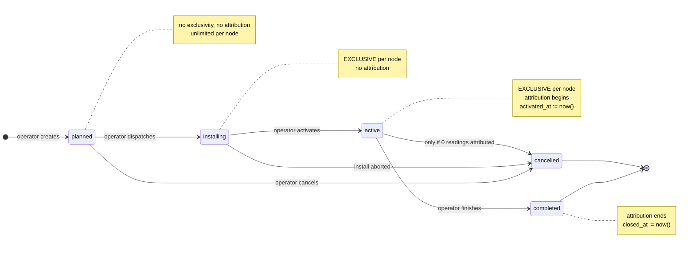

# Deployment integrity — final architecture review

**Review only. No implementation, schema, or data changes.**

Closes the design begun in `deployment-integrity-design.md` and revised in
`-rev2.md`. Answers the immutability, attribute-safety and state-machine
questions, and states implementation readiness.

---

## 1. Field immutability matrix

The governing rule is one sentence:

> **A field is frozen from the moment a reading can be attributed to the
> deployment — that is, from `active` onward.**

Before `active`, no reading references the deployment, so no edit can change any
reading's meaning. This is a principled boundary derived from the architecture,
not a policy preference.

`E` editable · `F` frozen · `A` automatic (system-written) · `—` not applicable

| Field | planned | installing | active | completed | cancelled |
|---|:--:|:--:|:--:|:--:|:--:|
| `node_id` | E | E | **F** | F | F |
| `building_id` | E | E | **F** | F | F |
| `electrical_panel_id` | E | E | **F** | F | F |
| `planned_start` | E | E | E | **F** | F |
| `planned_end` | E | E | E | **F** | F |
| `activated_at` | — | — | **A** | F | F |
| `closed_at` | — | — | — | **A** | A |
| `status` | transition only | transition only | transition only | F (terminal) | F (terminal) |

### Notes per field

**`node_id`, `building_id`, `electrical_panel_id`** — these three *define* what
attribution means. Editable during `planned` and `installing` because field
corrections are the normal case there (the technician finds the panel is
"Tablero B", or brings N002 instead of N001) and no reading is attributed yet.
`installing` has `allows_attribution = 0`, so this holds. Changing `node_id`
during `installing` re-validates exclusivity on the target node.

**`planned_start` / `planned_end`** — planning metadata, never authoritative for
attribution, so editing them cannot change any reading. Editable throughout the
non-terminal lifecycle: revising a schedule is normal. Frozen at terminal,
because at that point they become the historical record that "planned vs actual"
reporting is computed from.

**`activated_at`** — written automatically on the transition to `active`. Never
operator-editable, in any state. It is the attribution window's start; changing
it after readings exist would make the resolver produce different answers than
what those readings are stamped with.

**`closed_at`** — written automatically on the transition to a terminal state.
Same reasoning. Set once, then frozen.

**`status`** — never directly assignable. Only moves through validated
transitions.

---

## 2. Attribute safety

Attribution is stamped at ingest and immutable, so **no deployment edit can
change a stored reading's attribution**. The harm is subtler: an edit can create
**divergence** between what a reading is stamped with and what the resolver would
now produce for that reading's timestamp. That divergence silently breaks the
"one deployment per instant" guarantee retroactively and would surface as
disagreements in any future shadow run.

| # | Edit | What breaks | Remedy |
|---|---|---|---|
| 1 | `node_id` after `active` | Readings stamped node A attributed to a deployment claiming node B | **New deployment** |
| 2 | `building_id` after `active` | Deployment ends up owning readings in two buildings | **New deployment** |
| 3 | `electrical_panel_id` after `active` | Same class as 2 | **New deployment** |
| 4 | `activated_at` after set | Window start moves; readings near the edge resolve differently from their stamp | **Administrative override** (supervised migration only) |
| 5 | `closed_at` after set | Window end moves; same class as 4 | **Administrative override** (supervised migration only) |
| 6 | Backdating a **new** deployment over existing readings | Those readings keep their old stamp while the new deployment claims their instants | **Rejected** at creation |
| 7 | Reopening a terminal deployment | Re-opens a closed window, possibly overlapping later ones | **Rejected** — forbidden transition |
| 8 | Cancelling an `active` deployment that has attributed readings | `cancelled` does not attribute, so its readings become orphaned: stamped to a deployment that no longer claims them | **Rejected** — complete it instead |
| 9 | `planned_*` after terminal | Rewrites the historical schedule record | **Administrative override** |
| 10 | `planned_*` while non-terminal | Nothing — not authoritative for attribution | **Allowed** |

### Two rules this review surfaced

**Rule 6 — no backdating.** A new deployment's `activated_at` may not precede
the node's most recent reading. Without this, an operator can create a perfectly
valid-looking deployment that silently diverges from stored attribution for every
reading it retroactively covers. The partial unique index cannot see this; it
needs an explicit check against `MAX(timestamp) WHERE node_id = ?`.

**Rule 8 — cancel is only legal with zero attributed readings.** `cancelled`
means "called off"; if a campaign produced data, it happened, and the correct
terminal state is `completed`. This is checkable and closes an orphaning route
that neither the index nor the trigger would catch.

Both are application-level; neither is expressible as a constraint. They are the
two genuine residual risks from the Q5 analysis, now given remedies.

---

## 3. Final state machine

### Transitions

| From | To | Allowed | Guard | Automatic |
|---|---|:--:|---|---|
| `planned` | `installing` | yes | target node free of `installing`/`active` | — |
| `planned` | `cancelled` | yes | — | `closed_at := now()` |
| `planned` | `active` | **no** | must pass through `installing` | — |
| `installing` | `active` | yes | node `commissioned`; no backdating | **`activated_at := now()`** |
| `installing` | `cancelled` | yes | — | `closed_at := now()` |
| `installing` | `planned` | **no** | cancel and re-plan, so the aborted attempt stays in the record | — |
| `active` | `completed` | yes | warn if `buffer_pending > 0` | **`closed_at := now()`** |
| `active` | `cancelled` | yes | **only if 0 attributed readings** | `closed_at := now()` |
| `completed` | anything | **no** | terminal — create a new deployment | — |
| `cancelled` | anything | **no** | terminal | — |

### Protection layers

| Layer | Mechanism | Guarantees |
|---|---|---|
| **Database** | `CREATE UNIQUE INDEX ux_deployment_one_live_per_node ON deployments(node_id) WHERE status IN ('installing','active')` | At most one live deployment per node. Atomic, race-proof, holds against raw SQL |
| **Database** | Coherence trigger | terminal + attributing ⇒ `closed_at NOT NULL`; attributing ⇒ `activated_at NOT NULL` |
| **Database** | Immutability trigger | `BEFORE UPDATE` aborts changes to `node_id`, `building_id`, `electrical_panel_id`, `activated_at`, `closed_at` once `activated_at IS NOT NULL` |
| **Application** | `lifecycle.can_transition` | Only defined moves |
| **Application** | Backdating check | `activated_at >= MAX(reading.timestamp)` for the node |
| **Application** | Cancel guard | zero attributed readings |
| **Application** | Atomic supersede | close previous + activate next in one transaction |
| **Migration** | `INV-17` | no two live deployments per node |
| **Migration** | `INV-18` | terminal attributing ⇒ bounded window |

The index is the load-bearing guarantee; everything else either produces better
errors or catches what the index structurally cannot see.

---

## 4. The repair is now part of the backfill

This review changed the repair's character. `activated_at` and `closed_at` are
**new columns**. Populating them is not editing deployment 4 or deployment 6 — it
is choosing correct initial values for fields that do not yet exist.

Measured, not assumed:

| Dep | Node | Status | Attributed readings | Observed span |
|---:|---|---|---:|---|
| 4 | N001 | completed | 118,620 | 2026-06-14 21:57:34.692 → 2026-07-30 21:09:15.426 |
| 5 | N003 | completed | 32 | 2026-07-26 22:40:16 → 23:06:29 — **all 32 are contamination-window artifacts** |
| 6 | N001 | active | 220 | 2026-07-30 21:09:30.425 → ongoing |

Proposed backfill, for approval:

| Dep | `activated_at` | `closed_at` | Basis |
|---:|---|---|---|
| 4 | `2026-06-14 21:57:34.692` | `2026-07-30 21:09:15.426` | its own first and last attributed readings |
| 5 | `2026-06-14 00:00:00.000` | `2026-06-21 23:59:59.999` | its planned dates — its only attributed rows are known artifacts scheduled for M8 reconciliation |
| 6 | `2026-07-30 21:09:30.425` | `NULL` (active) | its own first attributed reading |

Deployment 4 closes 15.001 seconds before deployment 6 opens — one sampling
interval, with **zero readings in the gap and zero interleaving**.

**Acceptance criterion for M11**: re-run the shadow resolver after backfill.
`ATTRIBUTION_DIFFERS` must be **exactly the 32 contamination rows and nothing
else**. Any other disagreement means the backfill is wrong and must be rolled
back.

That criterion is strong: it verifies against all 226k readings that stored and
resolvable attribution agree everywhere except the one set already known to be
wrong and already scheduled for reconciliation.

Deployment 6's identity, node, building, panel, planned dates and status are
**not touched**. Only its new `activated_at` column is populated.

---

## 5. Open items

Neither blocks implementation of the integrity system.

1. **Rules 6 and 8 are new** (no backdating; cancel requires zero attributed
   readings). Both are recommendations from this review and need your agreement.
2. **`installing → planned` deliberately omitted.** An aborted installation
   should be `cancelled` and re-planned, so the attempt stays in the record.
   Say if you would rather allow the reversal.
3. **The backfill values in §4 need explicit approval**, particularly
   deployment 6's `activated_at`.
4. Unrelated and pre-existing: N003's declared context still needs physical
   confirmation before the M8 cutover.

---

## 6. Implementation readiness

**No further architectural issues remain. The design is implementation-ready**,
subject to your decision on the four open items above.

Every element earns itself against a concrete failure this project actually
encountered:

- The **four date/time fields** exist because deployment 4's planned and actual
  end genuinely differ, and D1 had to destroy one to express the other.
- **Attribution beginning at `active`** exists because `planned` reserving time
  would break scheduling.
- The **partial unique index** exists because it structurally prevents overlap
  rather than detecting it after the fact.
- **Rules 6 and 8** exist because the index cannot see backdating or orphaning.
- The **immutability matrix** exists because attribution is stamped once, so the
  fields defining it must stop moving the moment stamping can begin.

Implementation order: M10 (`is_exclusive`) → M11 (transition timestamps +
backfill, with the shadow acceptance criterion) → M12 (index, triggers,
`INV-17`/`INV-18`) → M13 (API). M12 follows the backfill, or the index installs
against a violating row.

Standard discipline throughout: timestamped backup, restore drill, dry run on a
copy, live migration, invariant verification, rollback verification. No
historical reading modified at any step.
