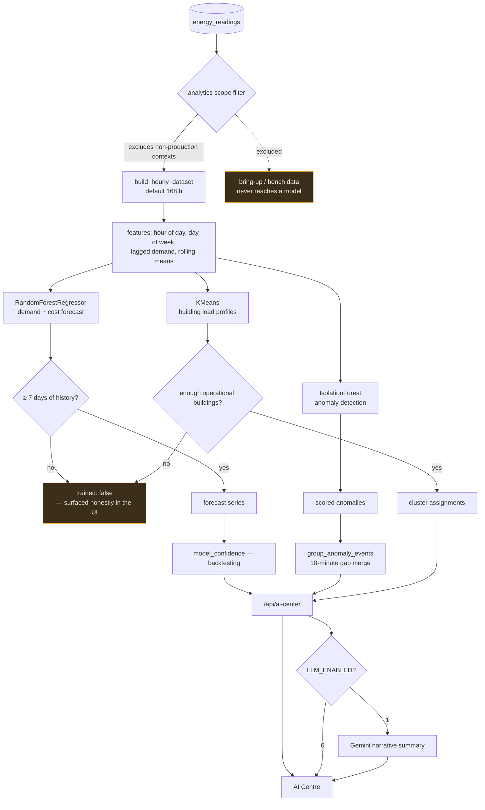

# AI and forecasting

Three scikit-learn models plus an optional LLM narration layer. Everything
numeric is computed locally and deterministically; the language model only
writes prose about figures it is handed, and the platform is fully functional
without it.

<div align="center">
  
  <br><sub>Centro IA — forecast with an explicit confidence basis</sub>
</div>

---

## The pipeline



---

## The models

| Model | Implementation | Answers |
|---|---|---|
| **Forecasting** | `RandomForestRegressor` | What will demand and cost be over the coming hours? |
| **Anomaly detection** | `IsolationForest` | Which intervals are unlike the rest of this node's behaviour? |
| **Clustering** | `KMeans` (`n_init=10`, `random_state=42`) | Which buildings share a load profile? |

All three live in [`backend/app/services/ml_engine.py`](../backend/app/services/ml_engine.py).

### Features

Built by `build_hourly_dataset(db, hours_back=168)` — one week by default:

- Hour of day and day of week (cyclical demand structure)
- Lagged demand
- Rolling means

Deliberately modest. With ~11 weeks of production data from one node, a
gradient-boosted ensemble on fifty engineered features would fit noise. A random
forest on obvious temporal features is the honest size of model for this dataset.

### Why not a neural forecaster

- The production series is **one node** with roughly two and a half months of
  continuous data.
- The server has no GPU, and inference must complete inside a dashboard request.
- A random forest's behaviour can be explained to a facilities manager who has
  to act on it.

If the fleet grows to dozens of nodes over a year of history, revisiting this is
reasonable. Today it would be decoration.

---

## Data scope

This is the part that matters most, and the part most easily got wrong.

> [!CAUTION]
> Building profiles trained on bench data were **the single worst source of
> wrong analytics** in this platform's history. Not a subtle bias — a model
> confidently describing the load profile of a building that was never measured.

Not every row in `energy_readings` is a measurement of a real building:

| Node | Range | Character | In scope? |
|---|---|---|---|
| N001 | 2026-06-14 → live | Real load, ~11.4 kW | ✅ |
| N003 | 2026-05-13 → 06-20 | Real prototype acquisition, ~21.5 kW | ⚠️ predates the deployment model |
| N003 | 2026-07-24 → | ADS1256 bring-up **at the noise floor**, ~0 kW | ❌ |
| N002 | — | Standby by design | — |

The scope filter enforces this through `measurement_contexts.counts_as_production`
before any dataset is built. `ml_engine` explicitly documents the reset guard at
the point where the forecaster would otherwise have been trained on a different
quantity than the one it predicts.

> [!NOTE]
> **Cost figures were never contaminated.** Every cost path filters
> `energy_kwh IS NOT NULL`, and N003 reported `NULL` on all 123,617 of its rows.
> The exposure was in the ML profiles, `anomaly_engine` and `metrics` — and that
> is where the filter was applied. See [Database.md](Database.md).

---

## Honesty guarantees

The system is built to say "I don't know" rather than to produce a confident
number from nothing.

| Guarantee | Mechanism |
|---|---|
| A model with insufficient history reports `trained: false` | Explicit guards in every model function; **the UI shows this state rather than hiding it** |
| Minimum 7 days of history before a forecast is offered | `minHistoryDays` in platform settings |
| Confidence is backtested, not asserted | `model_confidence.py` — "backtesting when sufficient history exists" |
| Clustering requires enough *operational* buildings | Guard in `kmeans_building_clusters` |
| Anomalies are grouped, not enumerated | `group_anomaly_events(items, max_gap_minutes=10)` — one 40-minute event, not 160 alerts |

That last row is the same lesson as the alerting policy, applied to analytics:
160 consecutive anomalous intervals are one event, and presenting them as 160
findings destroys the user's ability to act on any of them.

---

## Two different "anomaly" systems

They are easy to confuse and are not the same thing.

| | `anomaly_engine` | `ml_engine` IsolationForest |
|---|---|---|
| Method | Fixed threshold rules | Unsupervised learning |
| Thresholds from | `platform_settings` (UI display defaults) | The data's own distribution |
| Rules | Power factor, over-current, night consumption | — |
| Surfaces on | Anomalies screen | AI Centre |
| Can page a human | **No** | **No** |

Neither is the alerting system. Paging is [Monitoring.md](Monitoring.md), which
derives its thresholds from physical ratings rather than display defaults —
precisely because reusing display defaults for alerting caused the noise
incident.

---

## The LLM layer

`gemini_engine.py` produces narrative summaries over figures the statistical
layer has already computed.

```bash
LLM_ENABLED=1
GEMINI_MODEL=gemini-2.0-flash
GEMINI_API_KEY=...
```

**Boundaries, enforced by construction:**

- The LLM **never computes a number**. It receives computed values and writes
  prose about them.
- `LLM_ENABLED=0` disables every call. Forecasting, anomaly detection and
  clustering are unaffected — they are scikit-learn and run locally.
- No measurement data is sent beyond the aggregates needed for the summary.
- A missing `GEMINI_API_KEY` disables the feature rather than failing the
  process.

> [!IMPORTANT]
> If you are evaluating this repository: the forecasting is **not** an LLM
> wrapper. The models are scikit-learn, they run on the server, and the language
> model is an optional presentation layer that can be switched off without
> losing a single capability.

---

## Operating

| Setting | Where | Default |
|---|---|---|
| Forecasting on/off | Settings screen → `runtime_platform_settings.json` | on |
| Anomaly detection on/off | as above | on |
| Clustering on/off | as above | on |
| Minimum history | `ai.minHistoryDays` | 7 days |
| Training window | `build_hourly_dataset(hours_back=…)` | 168 h |

Models are trained on request rather than on a schedule. At this data volume
training takes seconds, and it removes an entire class of "the model is stale"
bugs. If the dataset grows by an order of magnitude, move to scheduled training
with persisted artefacts — `*.joblib` is already git-ignored for that reason.

---

## Roadmap

- Bring the base collector under version control so bring-up data is
  contextualised at capture rather than filtered afterwards.
- Weather as an exogenous feature — HVAC dominates campus load in Colima.
- Per-building models once more than one building is genuinely instrumented.
- Persisted models with scheduled retraining, when volume justifies it.
