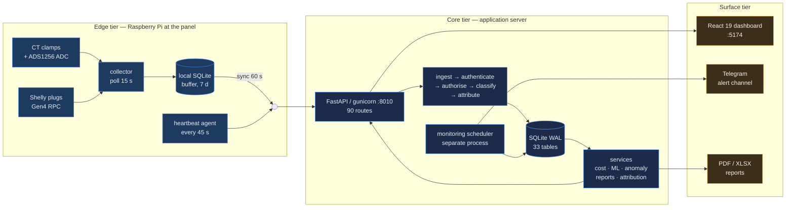
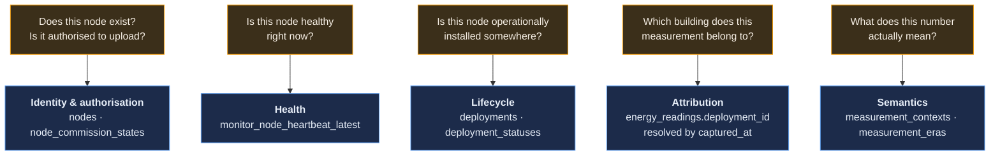
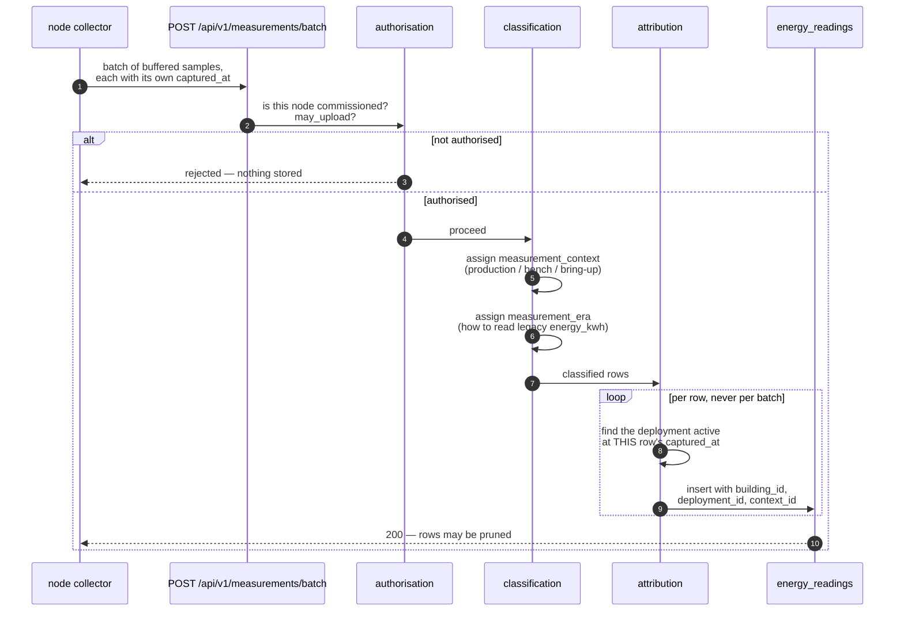

# Architecture

> The definitive technical reference for the backend is
> [`backend/docs/ARCHITECTURE.md`](../backend/docs/ARCHITECTURE.md), and the
> reasoning behind each major decision lives in
> [`backend/docs/adr/`](../backend/docs/adr/README.md). This document is the
> whole-system view: what the tiers are, what crosses between them, and which
> structural choices are load-bearing.

---

## 1. The shape of the system

Raspberry Pi nodes measure electrical load at building panels, buffer locally,
and synchronise to a central FastAPI backend over HTTP. The backend stores
readings, attributes them to installation campaigns, and serves analytics,
reports and monitoring.

### At a glance

| Tier | Runs on | Language | Process model |
|---|---|---|---|
| Edge | Raspberry Pi, one per panel | Python 3 | systemd units — collector, heartbeat |
| Core | Single application server | Python 3.12 | gunicorn `-w 1` + uvicorn worker, plus a separate scheduler process |
| Surface | Browser; Telegram | TypeScript / React 19 | Static build served with `Cache-Control: no-store` |

---

## 2. Four structural decisions

These are the choices that would be expensive to reverse. Everything else is
detail.

### 2.1 The monitoring scheduler is a separate process

It is not a background task inside the API.

- An in-process scheduler would **multiply alerts** the moment gunicorn moved
  off `-w 1`. Every worker would evaluate every rule.
- An in-process scheduler **cannot report that the backend crashed**, because it
  dies with it.
- A backend reload must not restart monitoring. Under `SIGHUP` the API's workers
  are replaced; the scheduler keeps its own clock and its own liveness record.

The cost is a second unit to operate and a second thing that can be down —
which is why the scheduler monitors *itself* and reports its own downtime.

### 2.2 The edge buffers, and the buffer is written before the upload

A backend outage delays data; it does not lose it. Each sample is committed to
the node's local SQLite buffer at capture time, and an independent loop drains
the buffer to the server.

This is what makes an otherwise alarming operation safe: ingestion may block for
minutes during a migration with no consequence beyond a temporarily deeper
buffer.

### 2.3 SQLite, in WAL mode, deliberately

Not a placeholder for PostgreSQL.

| Why it works here | The constraint it imposes |
|---|---|
| One writer (the ingest path), many readers (dashboards, reports, monitoring) | Concurrent writes are serialised; a long write blocks other writes |
| ~255k rows and ~180 MB — comfortably within SQLite's range | Backups **must** use the online backup API, never `cp` |
| No separate database process to operate, monitor or fail independently | Scaling past a single application server means a real migration |

> [!WARNING]
> The database runs in WAL mode with a live multi-megabyte WAL file. Copying
> `energy_platform.db` with `cp` produces a **silently corrupt** backup that
> looks fine until you restore it. Use
> `sqlite3 energy_platform.db ".backup out.db"`. See [Recovery.md](Recovery.md).

### 2.4 The backend contains no hardware-specific logic

A collector translates its device into the canonical measurement model; the
platform stores and interprets that model and nothing else.

Adding a new meter type is a collector change plus, at most, one row in
`measurement_eras`. It is never a change to the analytics layer. The contract is
specified in [`backend/docs/collector-contract.md`](../backend/docs/collector-contract.md)
and summarised in [Collector.md](Collector.md).

---

## 3. The five concepts

The redesign of 2026-07-26 exists because four distinct questions had collapsed
into two database columns. Each now has exactly one owner, and **no owner reads
another's state to answer its own question**.

| Question | Owner | Source of truth |
|---|---|---|
| Does this node exist? Is it authorised? | `Node` | `nodes`, `node_commission_states` |
| Is it healthy? | Monitoring | `monitor_node_heartbeat_latest` |
| Is it operationally installed? | Deployment | `deployments`, `deployment_statuses` |
| Which building does this reading belong to? | Attribution | `energy_readings.deployment_id` |
| What does this number mean? | Semantics | `measurement_contexts`, `measurement_eras` |

Why this matters in practice: before the split, "is this node online?" and "is
this node deployed?" were answered from the same column, so a node that was
alive but uninstalled looked identical to one that was installed but dead. The
alerting subsystem could not tell those apart, and 98% of its first production
run's noise came from exactly that confusion.

> [!NOTE]
> `Node.status` (`online` / `offline` / `available`) still exists as a legacy
> third vocabulary that disagrees with `last_sync`. It is a known wart: every
> consumer recomputes health rather than trusting it. See
> [Known limitations](#6-known-limitations).

---

## 4. The ingestion path

The one path that must never be wrong, because its mistakes are silent and
permanent.

The loop is per-row on purpose. Attributing a whole batch to the newest
deployment is correct only when the batch is fresh — and a node that has been
offline replays up to seven days of buffer at once.

---

## 5. Technology, and why

| Choice | Reason it is here |
|---|---|
| **FastAPI** | Typed request models and a generated OpenAPI schema, which is what makes [API.md](API.md) verifiable rather than aspirational. |
| **gunicorn `-w 1` + uvicorn worker** | One writer against SQLite. The single worker is a database constraint expressed in the process model, not an oversight. |
| **SQLite / WAL** | See [2.3](#23-sqlite-in-wal-mode-deliberately). |
| **React 19 + Vite + TypeScript** | Static build, no server-side runtime to operate. Deploy is a `npm run build`. |
| **Recharts** | Declarative charts over the same component model as the rest of the UI. |
| **scikit-learn** | Forecasting and anomaly detection that run on a modest server in seconds, and whose behaviour can be explained to a reviewer. |
| **systemd** | The nodes and the server already run it. It gives restart policy, ordering and journald without adding a runtime. |
| **Telegram** | The operators already carry it. Alert delivery that requires a new app is alert delivery that gets ignored. |

### What is deliberately absent

- **No containers.** The deployment target is one server and a handful of Pis
  that are managed as pets. Docker would add a layer without removing one.
- **No message broker.** The edge buffer already provides durability and
  backpressure; a broker would duplicate it.
- **No ORM migrations framework.** Migrations are hand-rolled with explicit
  up/down SQL, shadow runs against a copy, and invariant checks — because the
  hard migrations here rebuild a 255k-row table and Alembic's autogeneration
  would not have caught the index-collision-on-rename problem. See
  [Database.md](Database.md).

---

## 6. Known limitations

Stated plainly, because a portfolio that hides them is not an engineering
record.

| Limitation | Impact | Status |
|---|---|---|
| **No authentication on the ingestion endpoints** | `device_id` is self-asserted on `/api/v1/measurements/batch`, `/api/readings` and `/api/edge/heartbeat`. A forged heartbeat can suppress a real outage alert. | Documented in [ADR-0002](../backend/docs/adr/0002-upload-authorization.md) and [Security.md](Security.md). Not yet closed. |
| **Single application server** | No horizontal scaling and no failover. A host loss stops ingestion; the node buffers absorb up to seven days. | Accepted for the current scale. |
| **`Node.status` is a stale third vocabulary** | Disagrees with `last_sync`; consumers recompute health instead of trusting it. | Known wart; consumers are already correct. |
| **Frontend has no test suite** | Backend has six suites; the React app has none. | Acknowledged gap — see [Development.md](Development.md). |
| **Legacy deployment windows are not authoritative** | Deployment 4 declares 2026-06-14 → 06-21, but N001 has measured continuously since; only ~25% of its rows fall inside its own window. | Handled by [ADR-0006](../backend/docs/adr/0006-legacy-deployment-dates-non-authoritative.md); windows must be opened before any switch to strict timestamp attribution. |
| **Two of three nodes are not on production loads** | N002 is standby by design; N003's July data is ADS1256 bring-up at the noise floor. | Correctly excluded from analytics by the scope filter — see [AI.md](AI.md). |

---

## 7. Where to go next

- The data model in detail → [Database.md](Database.md)
- What the backend actually does per request → [Backend.md](Backend.md)
- How a measurement is produced → [Collector.md](Collector.md)
- How the system watches itself → [Monitoring.md](Monitoring.md)
- All 12 diagrams → [diagrams/](diagrams/README.md)
