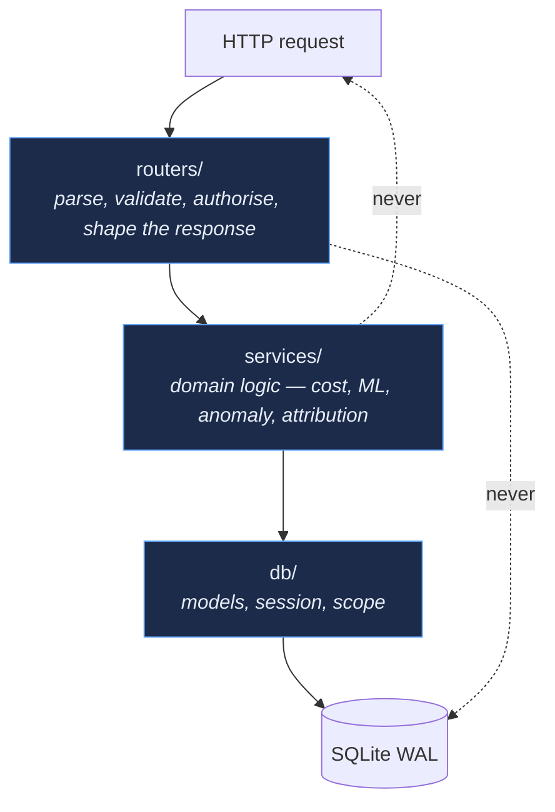
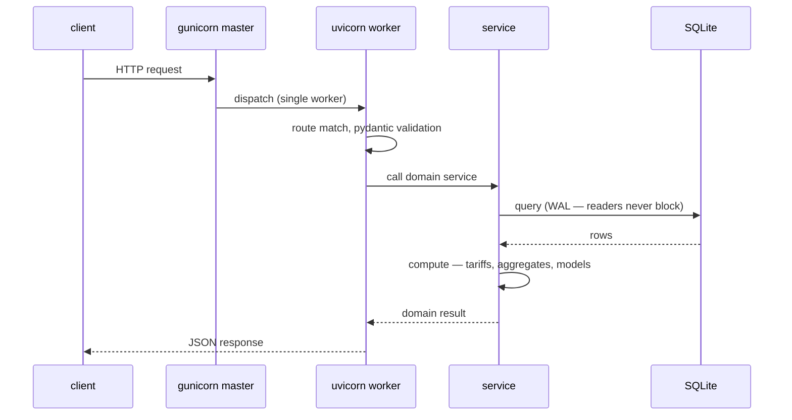

# Backend

FastAPI application serving **90 routes across 85 paths**, run under gunicorn
with a single uvicorn worker on port `8010`.

```
backend/
├── app/
│   ├── main.py            application assembly, CORS, router registration
│   ├── db/                models, session, seeding, lifecycle, scope
│   ├── routers/           20 routers — the HTTP surface
│   ├── services/          domain logic — no HTTP, no ORM session management
│   ├── monitoring/        self-contained monitoring subsystem (see Monitoring.md)
│   └── static/            institutional assets served by the API
├── migrations/            hand-rolled migration runner, 12 versions
├── tests/                 6 suites, plain-python assertions
└── docs/                  ADRs and the definitive backend reference
```

---

## Layering



The two dotted lines are the rules. A router never writes SQL directly, and a
service never knows it is being called over HTTP — which is why the same cost
engine backs the dashboard, the PDF report and the monitoring rules without
three implementations of the tariff arithmetic.

---

## Routers

| Router | Prefix | Responsibility |
|---|---|---|
| `dashboard` | `/api/dashboard` | Executive KPIs, aggregate rollups |
| `buildings` | `/api/buildings` | Building inventory and coverage |
| `nodes` | `/api/nodes` | Node inventory, commissioning, health summary |
| `deployments` | `/api/deployments` | Installation campaign lifecycle — 9 routes |
| `cost` | `/api/cost` | CFE tariff-based cost analytics |
| `ai` / `ai_center` | `/api/ai`, `/api/ai-center` | Forecasting, model status, narrative summaries |
| `org` | `/api/org` | Delegations, campuses, organisational units |
| `readings` | `/api/readings` | Legacy single-reading ingestion |
| `edge` | `/api/v1/measurements/batch`, `/api/edge/heartbeat` | Batch ingestion and heartbeat intake |
| `metrics` | `/api/metrics` | Live and historical electrical metrics |
| `anomalies` | `/api/anomalies` | Threshold-rule anomaly surface |
| `alerts` | `/api/alerts` | Legacy alert surface (deployment-gated) |
| `monitoring` | `/api/monitoring` | Monitoring subsystem API — 14 routes |
| `smart_plugs` | `/api/smart-plugs` | Shelly fleet — 7 routes |
| `reports` | `/api/reports` | PDF/XLSX generation — 13 routes |
| `data_explorer` | `/api/data-explorer` | Ad-hoc query surface |
| `mining` | `/api/mining` | Clustering and pattern analysis |
| `settings` | `/api/settings` | Runtime platform settings |
| `infra` | `/api/infra` | Infrastructure status |

Full route reference: [API.md](API.md), or the live schema at
`http://<host>:8010/docs`.

---

## Services

| Service | What it owns |
|---|---|
| `cost_engine` | CFE **GDMTH** tariff arithmetic — base/intermediate/peak periods, fixed charges, demand. The only place a rate is applied. |
| `cfe_scraper` | Scrapes published CFE tariffs so rates are not hard-coded and go stale. |
| `ml_engine` | RandomForest forecasting, IsolationForest anomalies, KMeans building profiles. See [AI.md](AI.md). |
| `anomaly_engine` | Threshold-rule anomalies (power factor, over-current, night consumption). Reads `platform_settings`; **deliberately does not import monitoring policy**. |
| `model_confidence` | Backtesting-based confidence for forecasts, so the UI can say "not enough history" instead of guessing. |
| `attribution` | Resolves each reading to a deployment by its own `captured_at`. |
| `deployment_ops` / `deployment_scope` | Lifecycle transitions and the analytics scope filter. |
| `energy_aggregate` / `energy_delta` | Rollups and interval-energy reconciliation. |
| `platform_settings` | Layered runtime settings from `runtime_platform_settings.json`. |
| `gemini_engine` | Optional LLM narration. Fully disabled by `LLM_ENABLED=0`. |

> [!IMPORTANT]
> `anomaly_engine` and `app/monitoring/` look similar and are not the same thing.
> `anomaly_engine` powers the **Anomalies screen** and reads UI display
> thresholds. `app/monitoring/` decides **whether to wake a human** and derives
> its thresholds from physical ratings. Colouring a chart and paging someone at
> 3 a.m. are different decisions, and conflating them was the direct cause of
> the alert-noise incident described in [Monitoring.md](Monitoring.md).

---

## Application assembly

`app/main.py` does four things and nothing else: loads `.env`, constructs the
app, applies CORS, and registers routers.

```python
from dotenv import load_dotenv
load_dotenv(dotenv_path='.env')          # must run before any router import
```

Two consequences worth knowing:

1. **The working directory matters.** `.env`, `runtime_platform_settings.json`
   and `energy_platform.db` are all resolved relative to `backend/`. The systemd
   unit sets `WorkingDirectory=`; a manual start from elsewhere silently loses
   configuration.
2. **Importing `app.monitoring` registers all 39 rules** and makes the
   `monitor_*` tables known to SQLAlchemy — but the API process **never creates
   them**. Table creation belongs to the scheduler, so the API can never alter
   the monitoring schema as a side effect of a reload.

### CORS

```python
allow_origins=["*"], allow_credentials=False
```

Permissive by design: the frontend is served from a different port on the same
host, and there are no cookies or credentials to protect. It is also honest
about the fact that **the API is currently unauthenticated** — see
[Security.md](Security.md).

---

## Request lifecycle



Reads never block each other under WAL. Writes serialise, which is why the
ingest path is kept short: authorise, classify, attribute, insert. Anything
expensive happens on the read side.

---

## Reload without downtime

The service runs as `manager`, so no root is needed:

```bash
kill -HUP $(systemctl show -p MainPID --value energy-platform-backend.service)
```

gunicorn starts replacement workers — which re-import the application and pick
up new code — then retires the old ones. No connection is dropped.

> [!NOTE]
> `SIGHUP` reloads the **API only**. The monitoring scheduler is a separate
> process and keeps running, by design. If you changed anything under
> `app/monitoring/`, restart the scheduler too — see [Deployment.md](Deployment.md).

---

## Testing

Six suites under `backend/tests/`, written as plain-python assertions with no
test framework, because **pytest is not installed on the deployment host** and
the tests must be runnable there.

```bash
cd backend
venv/bin/python3 -m tests.test_monitoring
venv/bin/python3 -m tests.test_deployment_lifecycle
venv/bin/python3 -m tests.test_collector
venv/bin/python3 -m tests.test_energy_aggregate
venv/bin/python3 -m tests.test_smart_plugs
venv/bin/python3 -m tests.test_synthetic_deployment
```

| Suite | Covers |
|---|---|
| `test_monitoring` | 329 checks over rules, severity, thresholds, and the alert-noise regression guards |
| `test_synthetic_deployment` | Drives the entire pipeline against a live synthetic campaign including a real overload |
| `test_deployment_lifecycle` | Status transitions, exclusivity, attribution windows |
| `test_collector` | The measurement contract and `energy_source` handling |
| `test_energy_aggregate` | Rollup and interval-energy arithmetic |
| `test_smart_plugs` | Shelly ingest, assignment, fleet state |

The monitoring suite's sections 19–25 are **sensitivity checks**: they assert
that real faults still fire while known noise stays silent. A monitoring system
that went quiet because it stopped looking is worse than one that is noisy, and
these tests are what stops that from happening unnoticed.

See [Development.md](Development.md) for the full local workflow.
