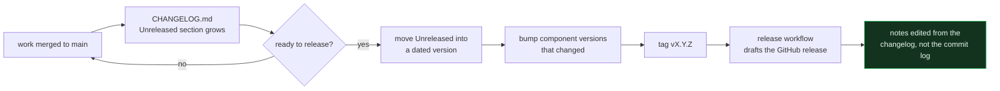

# Release history and process

The changelog itself lives at the repository root, where GitHub and most tooling
expect it:

## → [CHANGELOG.md](../CHANGELOG.md)

Component changelogs with finer detail:

| Component | Changelog |
|---|---|
| Edge / smart plugs | [`edge/CHANGELOG.md`](../edge/CHANGELOG.md) |
| Monitoring | [`monitoring/README.md`](../monitoring/README.md) |
| Architecture decisions | [`backend/docs/adr/`](../backend/docs/adr/README.md) |

---

## How releases are made

Versioning rules — including what counts as a breaking change for each of the
four independently released components — are in
[Versioning.md](Versioning.md).



### Why notes are written, not generated

A commit log is a record of *work*. Release notes describe *change* — what a
reader must now do differently. They are not the same document, and generating
one from the other produces notes full of "fix settings default fallback
references", which tells an operator nothing.

The changelog is therefore maintained as work lands, not reconstructed at
release time.

---

## Release notes template

```markdown
## vX.Y.Z — <short title>

<One paragraph: what changed and why it matters. Written for someone
who operates this platform, not for someone who wrote the code.>

### Upgrade

<Exact steps. If migrations are included, name them and say whether
they are reversible. If a node must be updated in lockstep, say so
here, in bold, first.>

### Added
### Changed
### Fixed
### Deprecated

### Breaking changes

<Or: "None." Never omit this heading — a reader must be able to
confirm the absence, not infer it.>

### Component versions

| Component | Version |
|---|---|
| Backend | |
| Frontend | |
| Edge | |
| Monitoring | |
| Migrations | 001–0NN |
```

---

## GitHub release strategy

| | |
|---|---|
| **Tags** | `vX.Y.Z`, annotated, on `main` |
| **Drafts** | Created by the release workflow on tag push; published by hand after review |
| **Pre-releases** | `vX.Y.Z-rc.N` for anything requiring a node-side update, so the fleet can be staged |
| **Assets** | None. There is no binary artefact — deployment is a `git pull`, a migration run and a reload. |
| **Latest** | Only stable releases are marked latest |

> [!IMPORTANT]
> A release that includes an irreversible migration is **MAJOR**, regardless of
> how small the change looks. Every migration in this repository ships a working
> `.down`, and that is a standing requirement rather than a convention — see
> [ADR-0005](../backend/docs/adr/0005-migration-invariants.md).
