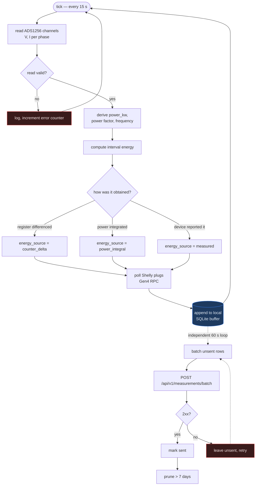
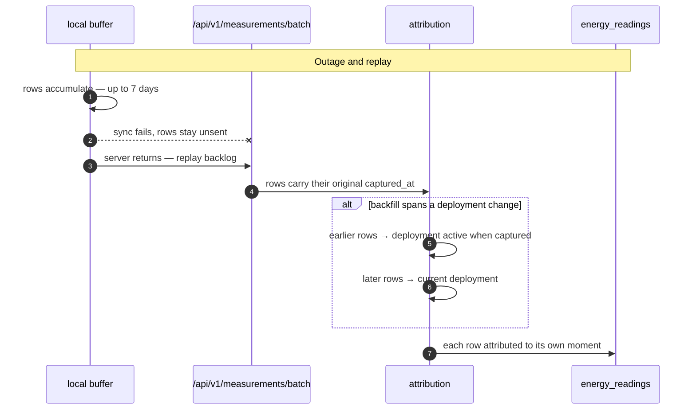

# Collector

The software on each Raspberry Pi that turns electrical signals into
measurements the platform understands, buffers them locally, and synchronises
them to the backend.

> The normative specification is
> [`backend/docs/collector-contract.md`](../backend/docs/collector-contract.md).
> That document is the contract; this one explains how the contract is met and
> why it is shaped that way.

---

## The rule the collector exists to enforce

**The backend contains no hardware-specific logic, now or ever.**

A collector translates its device into the canonical measurement model. The
platform stores and interprets that model and nothing else. Adding a meter type
is a collector change and, at most, one row in `measurement_eras` — never a
change to the analytics layer.

---

## The sampling loop



Two loops, deliberately independent:

| Loop | Period | Property |
|---|---|---|
| **Sample** | 15 s | Writes to the local buffer. Never touches the network. |
| **Sync** | 60 s | Drains the buffer. Never blocks sampling. |

The buffer is written **before** any upload is attempted. That single ordering
choice is what makes a backend outage a delay rather than a data loss, and it is
why ingestion can be paused for a migration without consequence.

---

## The payload

`POST /api/v1/measurements/batch` — a batch of these:

```json
{
  "node_id": "N001",
  "timestamp": "2026-07-31T20:15:00Z",

  "power_kw": 12.4,
  "interval_energy_kwh": 0.0517,
  "interval_seconds": 15.0,
  "energy_source": "measured",

  "meter_energy_kwh": 26411.882,
  "voltage": 127.3,
  "current": 97.4,
  "power_factor": 0.95,
  "frequency_hz": 60.0
}
```

### Mandatory fields

| Field | Meaning — fixed forever |
|---|---|
| `node_id` | The node's code, as registered |
| `timestamp` | UTC instant the sample was **taken**, not sent |
| `power_kw` | Instantaneous active power at that instant |
| `interval_energy_kwh` | Energy attributable to the interval this sample represents |
| `interval_seconds` | Length of that interval |
| `energy_source` | How `interval_energy_kwh` was obtained |

### Optional fields

| Field | Meaning |
|---|---|
| `meter_energy_kwh` | The device's own cumulative register — **reconciliation only** |
| `voltage`, `current`, `power_factor`, `frequency_hz` | Electrical quality |
| `phase_*_voltage`, `phase_*_current` | Three-phase detail |
| `phase_*_power_kw`, `phase_*_apparent_kva` | Per-phase power and apparent power (M15) |
| `phase_*_power_factor`, `phase_*_frequency_hz` | Per-phase quality (M15) |
| `apparent_kva`, `neutral_current` | Totals the meter publishes (M15) |
| `phase_*_energy_imported_kwh`, `phase_*_energy_returned_kwh`, `meter_energy_returned_kwh` | Meter registers (M15) |

The M15 fields exist because a read-only capture from N001's meter on
2026-08-18 showed the Shelly Pro 3EM publishes all of them in the response the
collector already parses, and the platform stored none of them. See
[Live-Monitoring.md](Live-Monitoring.md) for the full field matrix and
[Plan-Shelly-Phase-Fields.md](Plan-Shelly-Phase-Fields.md) for the migration.

---

## `energy_source` — why it is mandatory

Three legal values:

| Value | Use when |
|---|---|
| `measured` | The device reported interval energy directly |
| `counter_delta` | The collector differenced a cumulative register |
| `power_integral` | The collector integrated power over the interval |

> [!IMPORTANT]
> This is not decoration. `interval_energy_kwh: 0.0517` is **unfalsifiable**
> without it. With it, a reader knows whether the number came from a meter or
> from arithmetic — and therefore what its error characteristics are. The
> absence of exactly this information is what caused the incident that produced
> the contract.

`energy_kwh` is still accepted so existing collectors keep working. **New
collectors must not send it.** It is legacy, and its meaning is resolved per era
under [ADR-0007](../backend/docs/adr/0007-canonical-measurement-model.md).

---

## Mapping hardware families

### Devices with a lifetime register (Shelly Pro 3EM and similar)

The device exposes a monotonic counter. The collector differences it:

```python
delta = total_act_energy - previous_total_act_energy
if 0 < delta <= MAX_REASONABLE_DELTA_KWH:
    interval_energy_kwh = delta
    energy_source = "counter_delta"
```

The bound matters. A counter that resets — firmware update, power cycle,
rollover — produces a delta the size of the entire lifetime register. Clamping
turns a catastrophic single reading into a single missed interval.

### Raw analogue front ends (ADS1256 + CT clamps)

No register exists, so the collector integrates:

```
interval_energy_kwh = power_kw × interval_seconds / 3600
energy_source = "power_integral"
```

This is the path used by the production nodes. See [Hardware.md](Hardware.md).

---

## Synchronisation and replay



> [!WARNING]
> Attributing a **whole batch** to the newest deployment id — rather than each
> row to the deployment active at its own `captured_at` — silently and
> permanently files buffered data against the wrong building. With a ~19k-row
> buffer replaying after an outage, this is not a corner case. It was a real
> defect found in the 2026-07-26 audit and is the reason
> [ADR-0004](../backend/docs/adr/0004-immutable-timestamp-attribution.md) exists.

### Retention

The node prunes rows older than **7 days** once they are confirmed sent. That
window sets the maximum tolerable backend outage: beyond seven days, the oldest
data is genuinely gone.

---

## Repository contents

The **smart-plug source** and the **heartbeat agent** are in this repository:

| Path | Component |
|---|---|
| [`edge/smart_plug_source.py`](../edge/smart_plug_source.py) | Shelly Gen4 RPC source, folded into the collector loop |
| [`edge/integrate_collector.py`](../edge/integrate_collector.py) | Integration shim for an existing collector |
| [`edge/install-smart-plugs.sh`](../edge/install-smart-plugs.sh) | Idempotent installer |
| [`edge/smart-plug-health`](../edge/smart-plug-health) | Health probe |
| [`monitoring/edge/node_heartbeat.py`](../monitoring/edge/node_heartbeat.py) | Heartbeat agent, ~50 fields every 45 s |
| `edge/*.service` | systemd units |

> [!NOTE]
> **The base measurement collector — the ADS1256 sampling process itself — is
> not in this repository.** It is deployed and maintained directly on each Pi
> and has never been version-controlled centrally. Bringing it in is the top
> item on the [roadmap](../README.md#roadmap): it is the one part of the system
> whose source of truth is a device rather than a repository, which is precisely
> the property this platform's own migration discipline exists to avoid.
>
> Its behaviour is nonetheless fully specified by the contract above, and
> [`edge/HANDOFF-raspberry-pi.md`](../edge/HANDOFF-raspberry-pi.md) documents its
> installation and operation.

---

## Adding a new meter type

1. Write a source module that produces the canonical payload. Choose the correct
   `energy_source`; do not guess.
2. If the new device's `energy_kwh` means something different from the existing
   eras, add one row to `measurement_eras`.
3. Run `backend/tests/test_collector.py` — it tests the contract, not a device.
4. **Change nothing in `app/services/`.** If you find yourself needing to, the
   translation belongs in the collector and the design has been violated.
