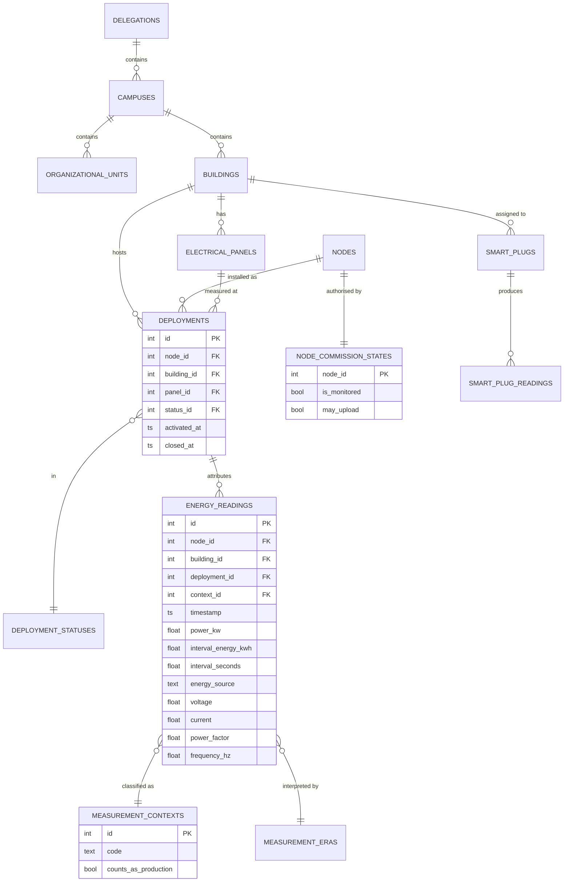
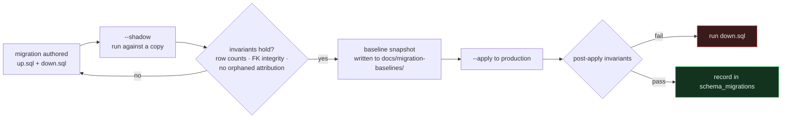

# Database

**SQLite in WAL mode**, at `backend/energy_platform.db`. 33 tables, ~180 MB,
**255,379 energy readings** spanning 2026-05-13 to the present.

```bash
# Reproduce every figure on this page
cd backend && python3 - <<'PY'
import sqlite3
c = sqlite3.connect('file:energy_platform.db?mode=ro', uri=True)
print(c.execute("select count(*) from energy_readings").fetchone())
print(c.execute("select min(timestamp), max(timestamp) from energy_readings").fetchone())
PY
```

---

## Why SQLite

This is a considered choice, not a placeholder for PostgreSQL.

| Fits | Costs |
|---|---|
| One writer (ingest), many readers (dashboards, reports, monitoring) — exactly the WAL sweet spot | Concurrent writes serialise |
| 255k rows, 180 MB — well inside SQLite's comfortable range | Scaling past one application server means a real migration |
| No second process to operate, monitor, back up or fail independently | No network access; the database is local to the API host |
| Backups are a single file | **`cp` produces a corrupt backup** — see below |

> [!CAUTION]
> The database has a live multi-megabyte WAL file. Copying it with `cp`, `rsync`
> or `tar` captures a torn state that looks valid and fails on restore. Always:
> ```bash
> sqlite3 energy_platform.db ".backup /path/to/backup.db"
> ```
> See [Recovery.md](Recovery.md).

---

## Schema



Full diagram with every table: [diagrams/§2](diagrams/README.md#2-database).

### Table groups

| Group | Tables | Purpose |
|---|---|---|
| Organisation | `delegations`, `campuses`, `organizational_units`, `buildings`, `electrical_panels` | Where things physically are |
| Identity & authorisation | `nodes`, `node_commission_states`, `node_commission_events`, `node_commission_transitions` | Whether a node exists and may upload |
| Lifecycle | `deployments`, `deployment_statuses`, `deployment_status_transitions` | Whether a node is operationally installed |
| Measurement | `energy_readings`, `measurement_contexts`, `measurement_eras`, `energy_semantics` | The data and what it means |
| Sub-metering | `smart_plugs`, `smart_plug_readings` | Per-outlet detail |
| Tariff | `tariff_periods` | CFE rate structure |
| Monitoring | `monitor_alerts`, `monitor_alert_events`, `monitor_node_heartbeats`, `monitor_node_heartbeat_latest`, `monitor_server_heartbeats`, `monitor_notification_outbox` | Owned entirely by the monitoring subsystem; **no existing table is modified** |
| Migration | `schema_migrations`, `migration_markers`, `*_pre_m*`, `m5_*_backup` | Version tracking and pre-migration snapshots |

### Current contents

| Table | Rows |
|---|---|
| `energy_readings` | 255,379 |
| `smart_plug_readings` | 34,975 |
| `monitor_server_heartbeats` | 12,772 |
| `monitor_alert_events` | 2,913 |
| `monitor_node_heartbeats` | 1,707 |
| `monitor_notification_outbox` | 1,654 |
| `monitor_alerts` | 574 |
| `organizational_units` | 72 |
| `campuses` | 10 |
| `tariff_periods` | 7 |
| `nodes` / `smart_plugs` / `deployments` / `buildings` | 3 / 4 / 3 / 2 |

---

## What the readings actually are

A row count is not a dataset. This matters for anyone evaluating the analytics:

| Node | Range | Character |
|---|---|---|
| **N001** | 2026-06-14 → live | Real load, ~11.4 kW, `energy_kwh` populated. The production series. |
| **N003** | 2026-05-13 → 06-20 | Real prototype acquisition, ~21.5 kW, 15 s cadence. Predates the deployment model. |
| **N003** | 2026-07-24 → | ADS1256 bring-up **at the noise floor**, ~0 kW. Not production data. |
| **N002** | — | Standby by design. |

This is why `measurement_contexts` exists. Analytics filter on
`counts_as_production`, so bring-up data never reaches a forecast — see
[AI.md § Data scope](AI.md#data-scope).

> [!NOTE]
> Cost figures are **not** contaminated by the bench data: every cost path
> filters `energy_kwh IS NOT NULL`, and N003 reported `NULL` on all 123,617 of
> its rows. The contamination risk was in the ML building profiles, and that is
> where the scope filter was applied.

---

## Migrations

No Alembic. Twelve hand-rolled migrations under `backend/migrations/versions/`,
each with explicit `.up.sql` / `.down.sql` (or a `.py` for the rebuilds), driven
by a runner that supports **shadow runs** and **invariant checks**.



```bash
cd backend
venv/bin/python3 -m migrations.runner --status
venv/bin/python3 -m migrations.runner --shadow      # dry run against a copy
venv/bin/python3 -m migrations.runner --apply
```

### The twelve

| # | Migration |
|---|---|
| 001 | Placeholder buildings |
| 002 | Node identity and authorisation |
| 003 | Deployment lifecycle |
| 004 | Rebuild `energy_readings` (Python — 225k rows, 12 steps) |
| 005 | Backfill measurement context |
| 006 | Analytics scope and contamination window |
| 007 | Node commissioning lookup |
| 008 | Physical ratings and node transitions |
| 009 | Deployment status exclusivity |
| 010 | Deployment operational timestamps (Python) |
| 011 | Deployment integrity protections |
| 012 | Canonical measurement model |

### Two hard-won lessons

> [!WARNING]
> **Renaming a table carries its indexes under their old names.** Drop the old
> indexes *before* the rename, or the subsequent `CREATE INDEX` collides and the
> migration fails halfway through a 255k-row rebuild. This is why migration 004
> is Python rather than SQL: it needs 12 ordered steps with checks between them.

> [!WARNING]
> `energy_readings.building_id` and `deployment_id` are **`NOT NULL`**. Making
> them nullable is not an `ALTER` — SQLite requires a full table rebuild. Plan
> for it.

Baselines and shadow reports for the riskiest migrations are committed under
[`backend/docs/migration-baselines/`](../backend/docs/migration-baselines/), so
the before-state of a production rebuild is part of the record rather than a
memory.

---

## Indexing and performance

The hot paths are time-range scans per node and per deployment. Indexes cover
`(node_id, timestamp)` and `(deployment_id, timestamp)`; `sqlite_stat1` is
populated, so `ANALYZE` has been run and the planner has real statistics.

If a dashboard query slows down after a bulk backfill:

```bash
cd backend && sqlite3 energy_platform.db "ANALYZE;"
```

---

## Related

- Attribution rules → [ADR-0004](../backend/docs/adr/0004-immutable-timestamp-attribution.md)
- Measurement semantics → [ADR-0007](../backend/docs/adr/0007-canonical-measurement-model.md)
- Migration invariants → [ADR-0005](../backend/docs/adr/0005-migration-invariants.md)
- Backup and restore → [Recovery.md](Recovery.md)
