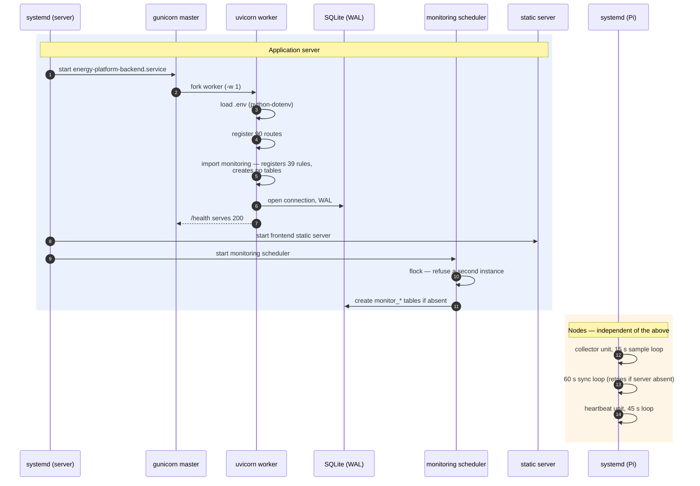
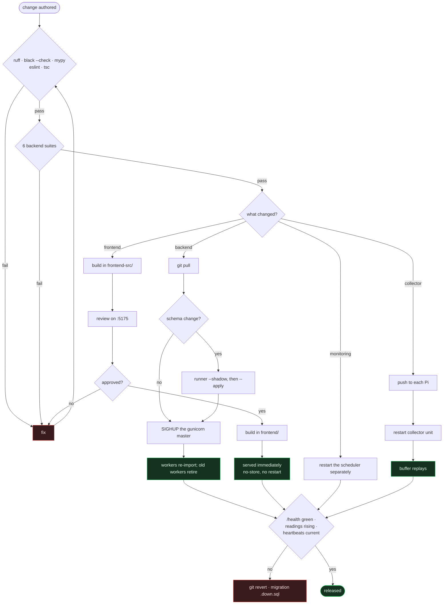

# Deployment

How the platform runs in production and how a change reaches it.

There is no container runtime and no orchestrator. This is systemd, gunicorn and
a static build on a single application server, plus a handful of Raspberry Pis
managed as pets. The process below describes what actually happens.

---

## What runs

| Unit | Port | Process | Purpose |
|---|---|---|---|
| `energy-platform-backend.service` | 8010 | `gunicorn app.main:app -k uvicorn.workers.UvicornWorker -w 1 --timeout 120` | API and ingestion |
| `energy-platform-frontend.service` | 5174 | `python3 static_server.py` | Production UI from `frontend/dist` |
| `energy-platform-monitoring.service` | — | `flock … python3 -m app.monitoring.scheduler` | Monitoring scheduler, **separate process** |
| *(staging, manual)* | 5175 | `python3 static_server_test.py` | Review environment |

On each node:

| Unit | Purpose |
|---|---|
| *(name varies per node)* | Measurement collector |
| `energy-node-heartbeat.service` | Heartbeat agent |
| `energy-collector-smartplugs.service` | Smart-plug source, when run standalone |

> [!IMPORTANT]
> `-w 1` is not a resource decision. SQLite has one writer; the single worker
> expresses that constraint in the process model. Raising it will produce
> `database is locked` under load.

---

## Boot order



Nothing waits on anything across the network. A node boots and starts buffering
whether or not the server exists, and the server boots whether or not any node
is alive.

---

## Release process



### Backend

```bash
cd /home/manager/energy-platform && git pull

# If the schema changed — always shadow first
cd backend
venv/bin/python3 -m migrations.runner --status
venv/bin/python3 -m migrations.runner --shadow
venv/bin/python3 -m migrations.runner --apply

# Graceful reload — no root required, no dropped connections
kill -HUP $(systemctl show -p MainPID --value energy-platform-backend.service)
```

gunicorn starts replacement workers that re-import the application, then retires
the old ones.

> [!NOTE]
> `sudo systemctl restart energy-platform-backend` needs a password that is not
> always available. `SIGHUP` works because the service runs as `manager`. Prefer
> it regardless: a restart drops connections, a reload does not.

### Monitoring

`SIGHUP` reloads the API only. The scheduler is a separate process **on
purpose** — if you changed anything under `app/monitoring/`, restart it too:

```bash
cd backend
OLD=$(python3 -c "import json;print(json.load(open('monitoring_watchdog.json'))['pid'])")
kill "$OLD"
sleep 3
cd ../monitoring && nohup ./run-monitoring.sh > /dev/null 2>&1 &

# Confirm a new pid and an advancing tick
sleep 25 && cd ../backend && python3 -c "import json;d=json.load(open('monitoring_watchdog.json'));print(d['pid'], d['tick'], d['updated_at'][:19])"
```

### Frontend

```bash
cd frontend
npm ci
npm run build          # → frontend/dist
```

The static server sends `Cache-Control: no-store`, so a completed build **is**
the release. No restart, no cache purge.

### Nodes

Push the changed file, restart the unit, confirm the buffer drains. The buffer
replays anything missed during the restart, so a brief collector outage costs
nothing.

```bash
sudo systemctl restart <collector-unit>   # name differs per node — check first
journalctl -u <collector-unit> -f
```

---

## Staging

The server carries a second checkout of the frontend at `frontend-src/`, served
on `:5175` by `static_server_test.py`. It is byte-identical to `frontend/` and
exists so a change can be reviewed before being repeated in production.

| | Production | Staging |
|---|---|---|
| Directory | `frontend/` | `frontend-src/` |
| Build output | `frontend/dist` | `frontend-src/dist` |
| Server | `static_server.py` | `static_server_test.py` |
| Port | 5174 | 5175 |

> [!WARNING]
> The two directories differ only by name, so it is genuinely easy to edit the
> wrong one. Confirm your path before building.

`frontend-src/` is **git-ignored**: it is a deployment artefact of this host, not
a second codebase. The repository tracks one frontend tree.

---

## Verification

After any release:

```bash
curl -s http://127.0.0.1:8010/health                      # {"status":"ok"}

# Readings still rising
cd backend && python3 -c "import sqlite3;print(sqlite3.connect('file:energy_platform.db?mode=ro',uri=True).execute('select count(*) from energy_readings').fetchone())"

# Heartbeats current
python3 -c "import sqlite3;print(sqlite3.connect('file:energy_platform.db?mode=ro',uri=True).execute('select code,last_sync from nodes order by code').fetchall())"
```

If ingestion has stopped but `/health` is green, the API is up and the **ingest
path** is broken — check node authorisation before anything else. See
[Troubleshooting.md](Troubleshooting.md).

---

## Rollback

| Change | Rollback |
|---|---|
| Backend code | `git revert`, then `SIGHUP` |
| Migration | Run the migration's `.down.sql` via the runner; a pre-migration baseline exists under `backend/docs/migration-baselines/` |
| Frontend | `git revert`, rebuild |
| Node collector | Restore from `edge/backups/`, restart the unit |

Data loss during a rollback is bounded by the node buffers: seven days.

---

## Environment

`.env` lives at `backend/.env`, mode `600`, git-ignored. Template:
[`backend/.env.example`](../backend/.env.example).

```bash
cp backend/.env.example backend/.env
chmod 600 backend/.env
```

> [!IMPORTANT]
> `.env` is loaded relative to the working directory. The systemd unit sets
> `WorkingDirectory=`; starting gunicorn by hand from elsewhere silently loses
> every credential and the platform will run with the LLM and Telegram
> disabled and no error to indicate why.

See [Security.md](Security.md).
