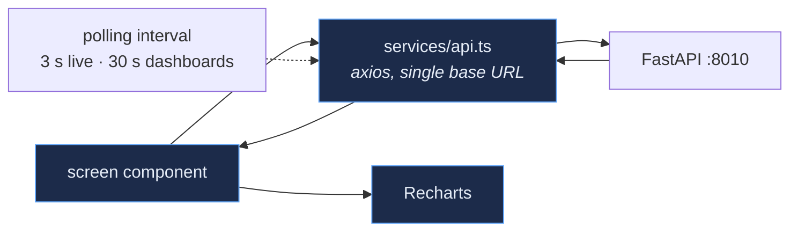

# Frontend

React 19 + TypeScript + Vite. A static build, served by a plain Python static
server — there is no Node runtime in production.

<div align="center">
  
  <br><sub>Dashboard Ejecutivo — live cost, tariff-period breakdown, weekly trend</sub>
</div>

---

## Screens

| Screen | Route label | What it answers |
|---|---|---|
| Executive dashboard | Dashboard Ejecutivo | What is this costing, and what changed? |
| Campus map | Mapa de Campus | Which physical buildings are monitored, and how are they? — real OSM footprints, see [CampusMap.md](CampusMap.md) |
| Buildings | Edificios | Which buildings are covered, which are not? |
| Deployments | Despliegues | What is installed where, and since when? |
| Live monitoring | Monitoreo en Vivo | What is the panel doing *right now*? |
| Cost analysis | Análisis de Costo | How does GDMTH tariff structure drive the bill? |
| AI centre | Centro IA / Forecasting | What will demand be, and how confident is that? |
| Data mining | Minería de Datos | What patterns group these loads? |
| Data explorer | Explorador de Datos | Let me query the raw series myself. |
| Reports | Reportes | Give me a PDF for someone who will not log in. |
| Infrastructure | Infraestructura | Are the nodes healthy? |
| Smart plugs | Smart Plugs | What is each individual outlet drawing? |
| Settings | Configuración | Thresholds, retention, tariff, AI toggles. |

<table>
<tr>
<td width="50%"><br><sub><b>Live monitoring</b> — V, A, kW, PF, Hz and buffer depth, 3 s refresh</sub></td>
<td width="50%"><br><sub><b>AI centre</b> — forecast with an explicit confidence basis</sub></td>
</tr>
<tr>
<td><br><sub><b>Smart plugs</b> — Shelly fleet state and per-outlet power</sub></td>
<td><br><sub><b>Deployments</b> — installation campaigns and their lifecycle</sub></td>
</tr>
</table>

More in [`assets/screenshots/`](../assets/screenshots/MANIFEST.md).

---

## Structure

```
frontend/
├── index.html
├── src/
│   ├── main.tsx                    entry, router
│   ├── App.tsx                     ~2.4k lines — most screens live here
│   ├── services/api.ts             the single axios client
│   ├── components/
│   │   ├── layout/                 Sidebar, Topbar
│   │   └── smartplugs/             the one fully extracted feature module
│   ├── pages/                      LoginPage, PageSettings, PageDataExplorer,
│   │                               PageSmartPlugs
│   ├── styles/theme.ts             design tokens
│   └── index.css                   CSS custom properties the tokens mirror
├── static_server.py                production server, :5174
└── static_server_test.py           staging server, :5175
```

### Styling

There is **no CSS framework** — no Tailwind, no styled-components. Styling is
inline `style={{}}` objects driven by token objects:

| Source | Scope |
|---|---|
| `src/styles/theme.ts` | Global tokens — colour, spacing, radius, type scale |
| `src/components/smartplugs/styles.ts` | Smart-plug module tokens |
| `src/pages/PageSettings.jsx` (`T` object) | Settings page tokens |
| `src/index.css` | CSS custom properties the token objects mirror |

> [!NOTE]
> This is honest about its trade-off. It keeps the build dependency-free and
> puts styles next to the markup they affect, but it concentrates a great deal
> of the UI in `App.tsx`. Extracting screens into modules the way
> `components/smartplugs/` already is would be the single highest-value
> refactor in the frontend — see [Roadmap](../README.md#roadmap).

### Dead code

`src/app.css`, `src/components/common.tsx`, `src/components/ui/*` and
`src/pages/CostAnalytics.tsx` are **not reachable from `main.tsx`**. They are
retained because parts are being migrated back into use, but nothing imports
them today. Do not treat them as examples of current style.

---

## Data flow



State is local React state plus polling. There is **no Redux, no React Query,
no WebSocket**. For a dashboard whose underlying data changes every 15 seconds
at the source, interval polling against a single client module is sufficient and
removes an entire category of cache-invalidation bugs.

Every request goes through `services/api.ts`, so the base URL and error handling
exist in exactly one place.

---

## Build and deploy

```bash
cd frontend
npm ci
npm run dev        # Vite dev server with HMR
npm run build      # tsc -b && vite build  →  frontend/dist
npm run lint
```

Deployment is the build. `static_server.py` serves `frontend/dist` with
`Cache-Control: no-store`, so a completed `npm run build` **is** the release —
no service restart, no cache purge.

> [!IMPORTANT]
> The repository tracks one frontend tree. The server also carries a second,
> byte-identical checkout at `frontend-src/`, served on `:5175`, used to review
> a change before it is repeated in production. That directory is a deployment
> artefact of that host and is git-ignored. See
> [Deployment.md § Staging](Deployment.md#staging).

---

## Localisation

The interface is **Spanish**; the codebase, comments and documentation are
English. The users are Mexican university facilities staff, and the tariff model
(CFE GDMTH) is Mexican. There is no i18n framework — strings are inline. Adding
one is only worth doing if a second locale is actually required.

---

## Known gaps

| Gap | Note |
|---|---|
| **No test suite** | The backend has six; the frontend has none. This is the largest quality gap in the repository. |
| `App.tsx` is ~2.4k lines | Most screens are not extracted into modules. |
| Dead code under `components/ui/` | Retained but unreachable; should be either revived or removed. |
| No accessibility audit | Contrast has been checked (see [branding](../assets/branding/README.md)); keyboard navigation and ARIA have not. |
