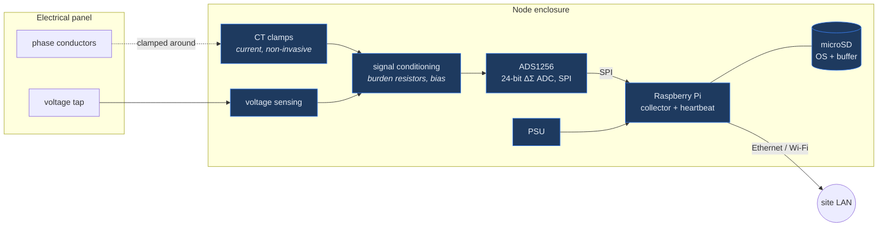

# Hardware

The physical layer: what is installed at a panel, what it measures, and how it
is put together.

> [!NOTE]
> Photographs of the installed hardware are the one outstanding gap in this
> repository's visual record. The images referenced below are listed in
> [`assets/screenshots/MANIFEST.md`](../assets/screenshots/MANIFEST.md#hardware-photographs)
> with capture guidance; until they are supplied, the references degrade to alt
> text.

---

## The fleet

Three nodes, deliberately not identical — the platform was built to tolerate a
heterogeneous fleet rather than to assume one.

| Node | Host | Board | Collector unit | Buffer |
|---|---|---|---|---|
| **N001** | — | Raspberry Pi | *(per-device)* | local SQLite |
| **N002** | `energy-node-002` | **Pi 5** | `energy-node-collector` | `/opt/energy-node/database/edge_buffer.db` |
| **N003** | `ucol-UBU` | **Pi 3 B+** | `udec-edge` (ADS1256 front end) | *(device-specific)* |

> [!IMPORTANT]
> **The collector unit name differs per node.** Determine it on the device
> before assuming it. This is a direct consequence of nodes having been built at
> different times by different hands, and it is exactly the kind of fact that
> gets a 3 a.m. recovery wrong. See [Recovery.md](Recovery.md).

Current node state is readable from the platform itself:

```bash
curl -s http://<host>:8010/api/nodes | python3 -m json.tool
```

---

## A node



<div align="center">
  
  
</div>

### Components

| Component | Role | Notes |
|---|---|---|
| **Raspberry Pi** (3 B+ / 5) | Runs the collector, the local buffer and the heartbeat agent | Mixed generations across the fleet |
| **ADS1256** | 24-bit delta-sigma ADC, 8 channels, SPI | Chosen for resolution at mains frequency; the bring-up of this front end is visible in the data as N003's July noise-floor series |
| **CT clamps** | Non-invasive current measurement | Split-core, clamped around phase conductors — **no conductor is broken to install a node** |
| **Voltage sensing** | Line voltage reference | Required for real power and power factor; current alone gives only apparent power |
| **microSD** | OS and the local measurement buffer | The most common hardware failure — see below |
| **PSU** | Power | The most common *root cause* — see below |

### Why a 24-bit ADC

Campus panels run at up to a few hundred amps, but the interesting behaviour —
overnight base load, a single failed HVAC compressor — sits far down the range.
An 8- or 10-bit converter quantises those away. The trade-off is that the front
end must be brought up carefully, and a mis-scaled channel reads as a plausible
small number rather than as an obvious error. That is precisely what N003's July
data is, and why it is excluded from analytics by context rather than by
deletion.

---

## Installation

<div align="center">
  
</div>

1. **De-energise, or work to the site's live-work procedure.** CT clamps are
   non-invasive, but the enclosure they sit in is not.
2. Clamp one CT per measured phase, observing orientation — a reversed CT
   reports negative power, which the platform will faithfully record.
3. Connect voltage sensing to the same phases the CTs are on. Mismatched
   phase pairing produces a power factor that is wrong in a way that looks
   plausible.
4. Mount the enclosure outside the panel where possible; inside, respect
   clearances and temperature.
5. Confirm network reachability from the node **outbound** — no inbound port
   forwarding is required. See [Networking.md](Networking.md).
6. Register the node, then commission it (`is_monitored`, `may_upload`), then
   open a deployment against the building and panel. Readings that arrive
   before a deployment exists are still stored, but their attribution is not
   what you expect — see [Collector.md](Collector.md).

> [!CAUTION]
> Do not open an energised enclosure to stage a photograph, and do not
> photograph H2 outside a scheduled maintenance window.

### Panel ratings matter to the software

`electrical_panels.rated_current_a` is not documentation — it is the **first
source** in the monitoring subsystem's threshold resolution chain. A node
installed against a panel with no recorded rating falls through to a learned
baseline, which is strictly worse. Record the breaker rating at installation.
See [Monitoring.md § Threshold resolution](Monitoring.md#threshold-resolution).

---

## Smart plugs

<div align="center">
  
</div>

**Shelly Plug US Gen4** × 4, on the site LAN over Wi-Fi. They are *accessories
of a deployment*, not nodes: they answer "which outlet is drawing the most"
during a campaign, and they never participate in energy-node ingestion.

Discovery and polling happen **only on the Pi**. The backend never scans a
network. See [Smart-Plugs.md](Smart-Plugs.md).

---

## Failure modes, in the order they actually occur

| Symptom in the heartbeat | Root cause | Action |
|---|---|---|
| `undervoltage` / `throttled` set | **Power supply or cabling.** By far the most common fault. | Replace the PSU or the cable; do not "wait and see" — undervoltage corrupts SD cards |
| `filesystem_readonly: true` | **SD card failing.** The kernel has remounted read-only to protect it. | Reflash from the node image; the card is not recoverable |
| `disk_percent` climbing | Buffer never pruned — usually a sync that has been failing silently | Check the upload path and `may_upload` authorisation |
| `cpu_temperature_c` high | Enclosure ventilation, or direct sun on the enclosure | Relocate or ventilate |
| No heartbeat, node pingable | Heartbeat unit down | `systemctl restart` the heartbeat unit |
| No heartbeat, node unreachable | Power, network, or hard failure | Site visit — see [Recovery.md](Recovery.md) |

The ordering is not arbitrary: undervoltage is upstream of most SD card
failures, so a card that fails twice in one location is a power problem, not a
card problem.

---

## Bench setup

<div align="center">
  
</div>

Bring-up and calibration happen on the bench before a node goes to a panel.

> [!WARNING]
> Bench data reaches the same database as production data. It is separated by
> `measurement_contexts`, **not** by a different table or a different endpoint.
> If you bring a node up while it is commissioned and deployed against a real
> building, you will attribute noise to that building. Commission and deploy
> *after* bring-up, in that order.

---

## Bill of materials

A complete, sourceable BOM with part numbers is **not yet recorded** — the
existing nodes were built incrementally rather than from a single specification.
Reconstructing it is on the [roadmap](../README.md#roadmap). What is known is
listed above; anything not listed above should not be assumed.
