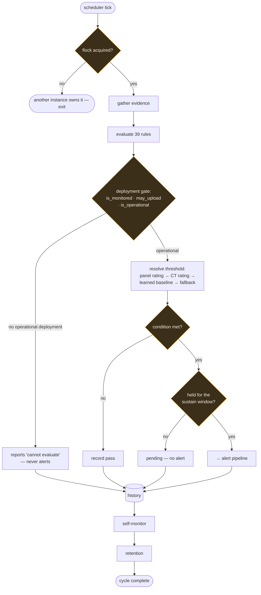
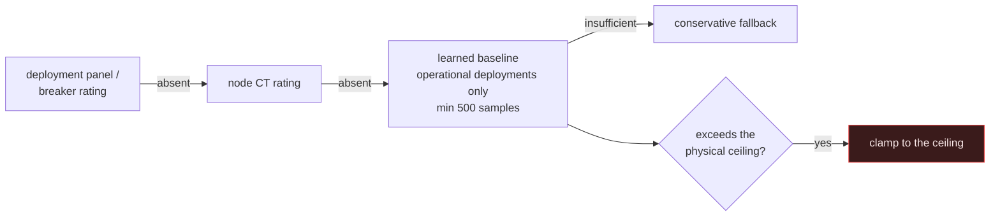
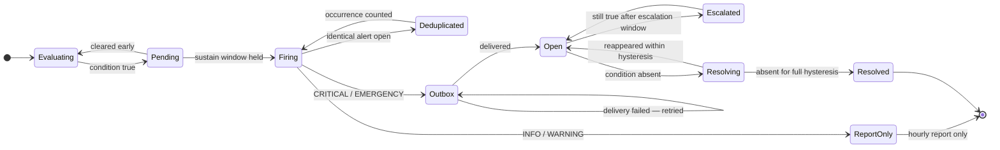
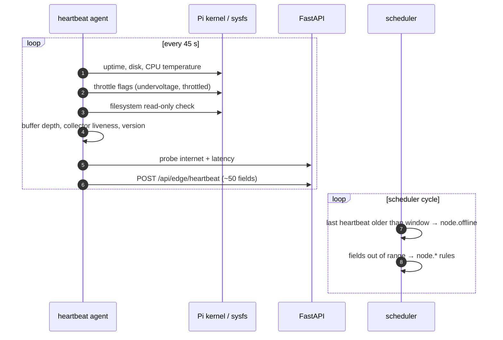

# Monitoring

Production monitoring for the platform. It answers, at any moment: *is
everything healthy; if not, what broke, where, since when, how bad is it, and
what should I check first?*

> Operator guide: [`monitoring/README.md`](../monitoring/README.md).
> This document covers the design and, more importantly, the **policy**.

**39 health rules** across nine subsystems. Built 2026-07-26; alerting policy
rebuilt 2026-07-29. Version 1.1.0.

---

## Capabilities

- **Node heartbeats.** Every Pi reports ~50 health fields every 45 s, separately
  from its measurements, so "the node is down" and "the node is up but not
  measuring" stay distinguishable.
- **39 health rules** across server, database, backend, network, node,
  electrical, smart-plug and monitoring-self subsystems.
- **Deployment-aware alerting** driven by the platform's own lifecycle tables,
  with sustain windows, hysteresis and report-only routing.
- **Alert lifecycle** — deduplication, duration-based escalation, automatic
  resolution, full audit trail.
- **Telegram delivery** through a durable outbox that never discards a message.
- **Hourly status report** covering the whole platform.
- **Self-monitoring** — the scheduler detects and reports its own downtime.

### Rule distribution

| Subsystem | Rules |
|---|---|
| Server | 15 |
| Electrical | 9 |
| Node | 7 |
| Network | 3 |
| Security | 2 |
| Backend | 1 |
| Database | 1 |
| Smart plug | 1 |
| **Total** | **39** |

```bash
# Reproduce
grep -rhoE '@rule\("[a-z_.]+"' backend/app/monitoring/*.py | cut -d'"' -f2 | cut -d. -f1 | sort | uniq -c
```

---

## Structure

```
backend/app/monitoring/
  config.py        layered typed config: defaults → monitoring_config.json → env
  severity.py      severity levels (INFO → EMERGENCY) and presentation
  models.py        six monitoring tables — no existing table is modified
  storage.py       own session factory, table creation, retention
  rules.py         rule registry and evaluation engine  ← the extension point
  health.py        server probes and server rules
  heartbeat.py     node heartbeat ingest, liveness, node rules
  metrics.py       electrical / plug / fleet metrics and rules
  thresholds.py    threshold resolution from physical reality
  lifecycle.py     deployment-state policy layer
  alerts.py        alert lifecycle — dedupe, escalate, resolve
  notifications.py durable outbox
  channels/        delivery — telegram.py
  scheduler.py     the separate process
  router.py        /api/monitoring — 14 routes
```

### It runs as its own process

```bash
systemctl status energy-platform-monitoring.service
```

Three reasons, each concrete:

1. An in-process scheduler would **multiply alerts** if gunicorn ever moved off
   `-w 1`.
2. It **could not report a backend crash**, because it would die with it.
3. A backend `SIGHUP` must not restart monitoring.

`run-monitoring.sh` wraps it in `flock`, so a second instance refuses to start
rather than double-alerting.

> [!IMPORTANT]
> Do not `pgrep` for the scheduler to check whether it is alive — it records its
> own liveness in `monitoring_watchdog.json` and in `monitor_server_heartbeats`.
> Read those instead.

---

## The pipeline



---

## Alerting policy

> [!CAUTION]
> The first production run of this system sent **1,386 Telegram messages in four
> days** — 697 on one day, 73 in a single hour. The policy below was rebuilt
> from that actual message history. The standard it is tuned to is: *"if I
> receive this at 3 a.m., would I actually get out of bed?"*

One meaningful alert per week beats fifty technically correct ones per day.
Normal electrical variation belongs in dashboards and the hourly report, never
in Telegram.

### Four principles, each learned from a specific failure

#### 1. Gate on deployment state first

98% of the noise — **1,288 of 1,312 messages** — came from nodes with no
operational deployment.

Read the platform's own tables: `node_commission_states` (`is_monitored`,
`may_upload`) and `deployment_statuses` (`is_operational`). Never invent a
parallel lifecycle model; `app/monitoring/lifecycle.py` is only a policy layer
over them.

#### 2. Never set a threshold inside the normal operating range

The 200 A default sat at N001's **94th percentile** and produced **962
messages** on its own.

Derive thresholds from a panel rating, or from the node's own trailing
percentile — and look at the distribution before choosing a number.

#### 3. Require persistence and hysteresis

**404 of 472 alerts lasted under two minutes.**

A condition must hold for a sustain window before notifying, and must be absent
for a hysteresis window before resolving. Without hysteresis, a value
oscillating on a threshold sends two messages per crossing, forever.

#### 4. Route by "would this page someone", not by whether it is true

Most rules are report-only. They must break out and page at CRITICAL. Power
factor 0.89 is noise; 0.55 is a fault on the same metric.

### Threshold resolution

Thresholds come from **physical reality, not statistics**:



> [!WARNING]
> A learned baseline may **never** exceed the physical ceiling. Otherwise it
> learns an overload as normal and stops reporting it — the failure mode where
> the monitoring system is quiet precisely because something is wrong.

> [!CAUTION]
> **Do not inherit `runtime_platform_settings.json` for alerting.** Those values
> (`maxCurrent: 200`, `minPowerFactor: 0.90`, `demandSpike: 25`) are **UI display
> defaults**, and they were the direct cause of the worst noise. Colouring a
> chart and paging a human are different decisions.

---

## Alert lifecycle



The outbox never discards a message. A Telegram outage delays delivery; it does
not lose the alert.

---

## Heartbeats



Notable fields: `undervoltage` and `throttled` (from the Pi's throttle
register), `filesystem_readonly` (an SD card about to fail), `cpu_temperature_c`,
`disk_percent`, buffer depth, and `latency_ms` to the backend.

> [!NOTE]
> Heartbeat alerting iterates **every node unconditionally** and is correctly
> decoupled from deployment state — a node that is uninstalled but should be
> alive is still reported. Only the legacy `routers/alerts.py` is
> deployment-gated, and therefore silent by design.

---

## Verifying a change

After any tuning, run the sensitivity checks:

```bash
cd backend
venv/bin/python3 -m tests.test_monitoring            # sections 19–25
venv/bin/python3 -m tests.test_synthetic_deployment  # full pipeline, real overload
```

They assert that **real faults still fire** — missing phase, overload, power
loss, power-factor collapse — while the **known noise stays silent**.

> [!IMPORTANT]
> A monitoring system that went quiet because it stopped looking is worse than
> one that is noisy. Never tune for silence without running these.

---

## Extending

Add a rule in the subsystem module that owns the evidence:

```python
@rule("electrical.phase_imbalance", Subsystem.ELECTRICAL,
      "Phase current imbalance beyond the panel's tolerance")
def phase_imbalance(ctx) -> RuleResult: ...
```

Before you merge it, answer all four:

1. Is it gated on deployment state?
2. Is its threshold outside the normal operating range, and derived from a
   physical rating?
3. Does it have a sustain window and hysteresis?
4. Would you get out of bed for it? If not, it is report-only.
