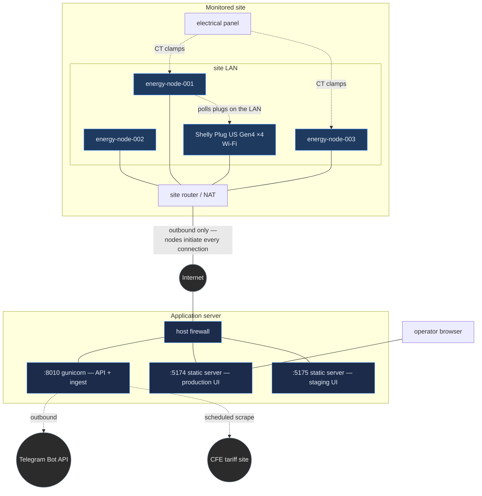

# Networking

Topology, ports, and how the tiers reach each other.

> [!IMPORTANT]
> No addresses, hostnames or credentials for the real deployment appear in this
> repository. Where an operator needs one, it belongs in a private runbook — not
> in a public document. See [Security.md](Security.md).

---

## Topology

---

## The property that makes this deployable

**Every connection is initiated outbound from the node.**

No inbound port is forwarded to a Raspberry Pi for the platform to work. A node
dropped onto an ordinary consumer network — a building's existing Wi-Fi, a
router nobody wants to reconfigure — works with zero network changes.

This is also why discovery of the smart plugs runs **on the Pi** rather than
centrally: a central scanner would need inbound reach into every site, and would
forfeit exactly this property. See [Smart-Plugs.md](Smart-Plugs.md).

Operator SSH access to a node is a *separate concern* from the platform's
operation, and is discussed below.

---

## Ports

### Application server

| Port | Service | Exposure |
|---|---|---|
| 8010 | gunicorn — API and ingestion | Reachable by nodes and by the frontend host |
| 5174 | Static server — production UI | Operators |
| 5175 | Static server — staging UI | Operators, review only |

Outbound from the server: Telegram Bot API (alerts), the CFE tariff site
(scheduled scrape), and the Gemini API when `LLM_ENABLED=1`.

> [!WARNING]
> 8010 carries the **unauthenticated** ingest endpoints. Firewall it so that
> only the node addresses and the frontend host can reach it. See
> [Security.md § Known gaps](Security.md#known-gaps).

### Node

| Direction | Purpose |
|---|---|
| Outbound HTTP → server:8010 | Measurement batches (60 s), heartbeats (45 s) |
| Outbound HTTP → plugs on LAN | Shelly Gen4 RPC polling |
| Inbound | **None required by the platform** |

### Smart plugs

Shelly Gen4 RPC over HTTP on the site LAN. Identity is the device **MAC**, not
its IP, because DHCP moves them.

---

## Reaching a node for maintenance

Operational access is deliberately not part of the data path.

- **Nodes are reached over the site's public NAT address**, not over an overlay
  network. An overlay was evaluated; the addresses that actually work are the
  NAT ones, and assuming otherwise wastes time during an incident.
- **Collector unit names differ per node.** Determine the unit on the device;
  do not assume it matches another node. See [Hardware.md](Hardware.md).
- **At least one node runs `fail2ban` and will ban on a wrong password.** Get
  the credential right the first time, or you will lock yourself out of the node
  you are trying to recover.

> [!CAUTION]
> That last point has bitten before. If you are unsure of a node's credential,
> confirm it *before* connecting — a ban during an outage turns a five-minute
> fix into a site visit.

Site-specific addresses and credentials belong in a private runbook.

---

## Failure behaviour

| Failure | Effect | Recovery |
|---|---|---|
| Site loses internet | Nodes buffer locally, up to **7 days** | Automatic on restore; the buffer replays |
| Server unreachable | Same as above — sync retries every 60 s | Automatic |
| Node loses LAN | No plug polling; panel measurement continues | Automatic |
| Server down | No ingestion, no dashboards, **no alerting** | Restart; nodes replay |
| Telegram unreachable | Alerts recorded; delivery retried from the durable outbox | Automatic — nothing is discarded |

The pattern throughout: **network failures cause delay, not loss.** The one
exception is a site outage longer than seven days, at which point the node's
retention window has genuinely expired.

---

## Latency

The heartbeat agent measures round-trip latency to the backend and reports it as
`latency_ms`. It is monitored by the `network.*` rules — three of the 39 — and is
useful mostly as a leading indicator: a node whose latency degrades before it
disappears usually has a Wi-Fi or upstream problem rather than a power problem.

---

## If you deploy this elsewhere

- Give the API a TLS terminator and firewall 8010 to known sources.
- Do not expose 5174/5175 to the internet — they serve an interface with no
  server-side authentication behind it.
- Keep the outbound-only property for nodes. It is the reason this deploys into
  buildings whose networks you do not control.
