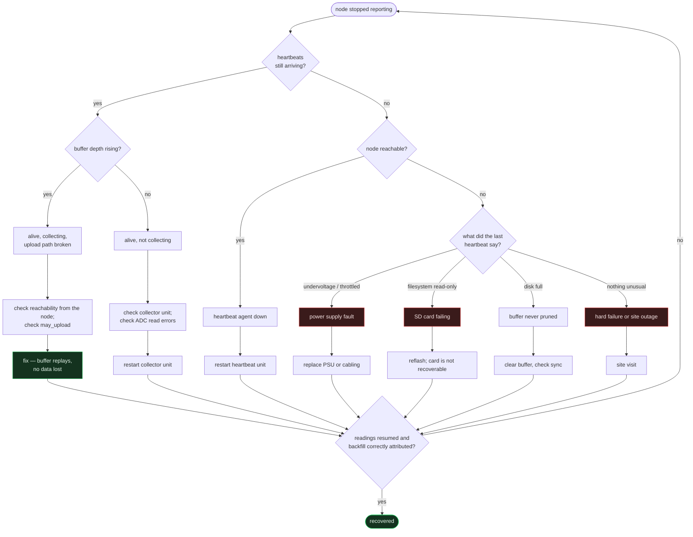

# Recovery

Backup, restore, and getting a broken node back into service.

---

## Backing up the database

> [!CAUTION]
> **Never back up `energy_platform.db` with `cp`, `rsync`, `tar` or a filesystem
> snapshot.** The database runs in WAL mode with a live multi-megabyte WAL file.
> A file copy captures a torn state that *looks* valid, restores without error,
> and is missing or corrupting recent transactions. You will not find out until
> you need the backup.

Use SQLite's online backup API, which is safe against a live writer:

```bash
cd /home/manager/energy-platform/backend
sqlite3 energy_platform.db ".backup /path/to/backups/energy_platform-$(date +%Y%m%d_%H%M%S).db"
```

Verify every backup before trusting it:

```bash
sqlite3 /path/to/backup.db "PRAGMA integrity_check;"        # expect: ok
sqlite3 /path/to/backup.db "select count(*) from energy_readings;"
```

An integrity check that passes and a row count in the expected range are the
minimum. A backup that has never been restored is a hypothesis, not a backup.

### What else to keep

| Item | Why |
|---|---|
| `backend/.env` | The only credentials in the system. Store separately, encrypted. |
| `backend/runtime_platform_settings.json` | Operator-tuned thresholds and tariff configuration |
| `backend/monitoring_config.json` | If present — monitoring overrides |
| The repository itself | Code is recoverable from git; these files are not |

> [!IMPORTANT]
> Backups live on the application server today. That means a host loss takes the
> backups with it. Moving them off-host is on the [roadmap](../README.md#roadmap)
> and is the largest single gap in this platform's durability story.

---

## Restoring

```bash
# 1. Stop everything that writes
sudo systemctl stop energy-platform-backend energy-platform-monitoring

# 2. Preserve the current state — even if you believe it is broken
mv energy_platform.db     energy_platform.db.pre-restore
mv energy_platform.db-wal energy_platform.db-wal.pre-restore 2>/dev/null
mv energy_platform.db-shm energy_platform.db-shm.pre-restore 2>/dev/null

# 3. Restore and verify BEFORE starting anything
cp /path/to/backup.db energy_platform.db
sqlite3 energy_platform.db "PRAGMA integrity_check;"
sqlite3 energy_platform.db "select count(*), max(timestamp) from energy_readings;"
sqlite3 energy_platform.db "select version from schema_migrations order by version desc limit 1;"

# 4. Start
sudo systemctl start energy-platform-backend energy-platform-monitoring
curl -s http://127.0.0.1:8010/health
```

Step 3's third query matters: **the restored database's schema version must
match what the deployed code expects.** Restoring an older backup under newer
code needs the intervening migrations replayed:

```bash
cd backend && venv/bin/python3 -m migrations.runner --status
```

### Data loss window

Restoring loses everything between the backup and now — **except** whatever is
still in the node buffers, which replays automatically. With a seven-day buffer
and a recent backup, a restore is usually close to lossless. That is the whole
point of buffering at the edge.

---

## Node recovery



The tree is ordered by **what the evidence can distinguish**, not by what is
easiest to check. The first question separates "the node is gone" from "the node
is here but something downstream is wrong", and those have almost no remedies in
common.

### Reading the evidence

```bash
# Last heartbeat per node, with the fields that matter
cd backend && python3 - <<'PY'
import sqlite3
c = sqlite3.connect('file:energy_platform.db?mode=ro', uri=True)
for r in c.execute("""
    select node_id, timestamp, undervoltage, throttled,
           filesystem_readonly, disk_percent, cpu_temperature_c
    from monitor_node_heartbeat_latest"""):
    print(r)
PY
```

### Rebuilding a node

1. Reflash the OS image.
2. Restore the collector and its configuration; **confirm the unit name** — it
   differs per node.
3. Install the heartbeat agent (`monitoring/edge/`).
4. Install the smart-plug source if the node polls plugs (`edge/`).
5. Confirm the node's identity and `may_upload` in `node_commission_states`.
6. Confirm an open deployment exists for the building and panel.

> [!WARNING]
> Bring the node up **before** commissioning and deploying it, not after. A node
> that is commissioned and deployed while its analogue front end is still being
> calibrated attributes noise to a real building. This is not hypothetical — it
> is what N003's July series is, and it is why `measurement_contexts` exists.
> See [Hardware.md](Hardware.md).

Data lost while a node was down is genuinely lost only beyond the seven-day
buffer window. Within it, the replay handles itself — and each row is attributed
to the deployment that was active at its own `captured_at`, so a backfill that
spans a deployment change still lands correctly.

---

## Losing the application server

Order matters here.

1. **Nodes keep buffering.** You have seven days. Do not rush into a bad
   restore.
2. Rebuild the host, install the repository, recreate the virtualenv from
   `backend/requirements.txt`.
3. Restore `backend/.env` from wherever you stored it. Without it, monitoring
   comes back silent.
4. Restore the database, verifying schema version as above.
5. Start the backend, then the monitoring scheduler, then the static servers.
6. Nodes reconnect on their own — no node-side action is required.

If no database backup exists, the platform still recovers *structurally*
(migrations rebuild the schema) but the history is gone beyond what the node
buffers hold.

---

## Monitoring the recovery itself

The monitoring subsystem records its own downtime and will report the gap once
it is back. Do not silence it during a recovery — that record is how you find
out whether the outage was five minutes or five hours.

```bash
cd backend && python3 -c "import json;d=json.load(open('monitoring_watchdog.json'));print(d['pid'], d['tick'], d['updated_at'][:19])"
```

---

## Drill

A recovery procedure that has never been executed is a document, not a
capability. At minimum, once per quarter:

- [ ] Take a backup with the online API
- [ ] `PRAGMA integrity_check` it
- [ ] Restore it to a scratch path and confirm row counts and schema version
- [ ] Confirm the restored copy's most recent reading is where you expect
