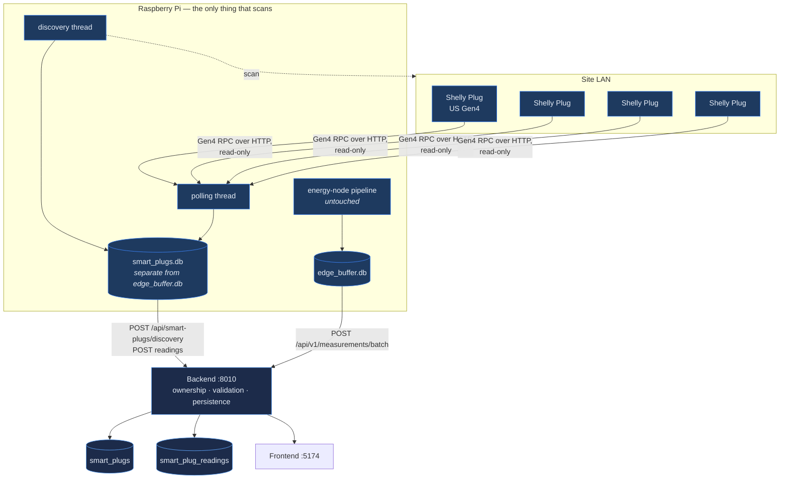
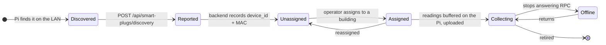

# Smart plugs

Per-outlet sub-metering with **Shelly Plug US Gen4**, answering the one question
a panel-level node cannot: *which outlet or appliance is actually consuming the
most?*

> Deep reference: [`Smart-Plug-Architecture.md`](Smart-Plug-Architecture.md).
> Raspberry Pi side: [`edge/README-smart-plugs.md`](../edge/README-smart-plugs.md).
> API: [`backend/docs/smart-plugs-api.md`](../backend/docs/smart-plugs-api.md).

<div align="center">
  
  <br><sub>Fleet state, per-plug power, and building assignment</sub>
</div>

**Current fleet: 4 plugs, 34,975 readings.**

---

## The design decision that shapes everything

Smart plugs are **accessories of a deployment, not Energy Nodes.**

They never participate in energy-node ingestion, and the energy-node tables are
never written by this subsystem. It has its own tables (`smart_plugs`,
`smart_plug_readings`), its own buffer file on the Pi, and its own API prefix.

Why this matters: a plug and a node measure fundamentally different things. A
node measures a panel; a plug measures an outlet downstream of that panel.
Summing them would double-count. Keeping them in separate tables makes that
mistake structurally impossible rather than a rule someone has to remember.

---

## Architecture



> [!IMPORTANT]
> **The cloud never scans anything.** Discovery runs only on the Pis; the
> backend receives what each Pi already found. A central scanner would need
> inbound network reach into every site, which is exactly the property that lets
> this system work behind ordinary consumer NAT.

Two threads on the Pi, and a **separate SQLite file** from the energy-node
buffer — so a plug subsystem fault cannot corrupt or block the measurement path
that matters most.

---

## Lifecycle of a plug



A discovered plug is **unassigned** until an operator assigns it. Unassigned
plugs still report — they just aren't attributed to a building. The Smart Plugs
screen surfaces the unassigned count precisely so they don't sit forgotten.

Identity is the device's **MAC**, not its IP. DHCP moves plugs around; MAC
survives it.

---

## API

| Method | Route | Purpose |
|---|---|---|
| `GET` | `/api/smart-plugs` | Fleet inventory with assignment and state |
| `GET` | `/api/smart-plugs/live` | Current power per plug |
| `GET` | `/api/smart-plugs/{id}/history` | Time series for one plug |
| `POST` | `/api/smart-plugs/discovery` | Pi reports what it found |
| `POST` | `/api/smart-plugs/{id}/assign` | Assign to a building |

Seven routes in total; see [API.md](API.md).

---

## Installing on a node

```bash
# On the Raspberry Pi
sudo ./install-smart-plugs.sh
```

The installer is **idempotent** — safe to re-run. It backs up what it replaces
into `edge/backups/`.

Two ways to run the source:

**A. Inside the existing collector (preferred).** `SmartPlugSource` is a plain
class with its own daemon threads, so the collector keeps ownership of the
process, its watchdog and its logging:

```python
from smart_plug_source import SmartPlugSource

plug_source = SmartPlugSource(
    node_id="N001",                       # the same Node code the collector uses
    backend_url="http://<backend>:8010",
)
```

**B. Standalone**, via `energy-collector-smartplugs.service`, when the existing
collector cannot be modified.

Configuration: copy `smart-plugs.conf.template` to `smart-plugs.conf` and edit.
The real file is git-ignored.

Health check:

```bash
./smart-plug-health
```

---

## Operational notes

| Fact | Consequence |
|---|---|
| Polling is **read-only** RPC | The platform never switches a plug on or off. It is a meter, not an actuator. |
| Readings are buffered on the Pi **before** upload | A backend outage delays plug data as well; same guarantee as the measurement path. |
| Plugs are on Wi-Fi | They drop out more than the wired nodes do. `smart_plug.*` rules are report-only for this reason — a plug that vanishes for ninety seconds is not worth a 3 a.m. message. |
| Shelly reports both instantaneous power and a cumulative register | The register is differenced with a clamp, exactly as in the [collector contract](Collector.md#energy_source--why-it-is-mandatory). |

---

## Versioning

The edge component versions independently of the platform: `edge/VERSION` is
currently **1.2.0**, with history in
[`edge/CHANGELOG.md`](../edge/CHANGELOG.md). See [Versioning.md](Versioning.md).
