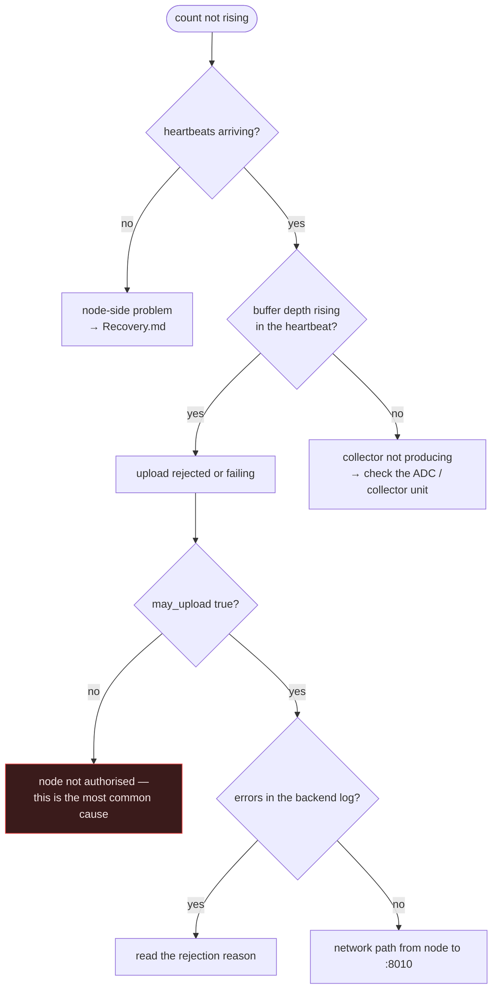

# Troubleshooting

Organised by **symptom**, because that is what you have when something is wrong.

For getting a broken node or a lost database back, see [Recovery.md](Recovery.md).

---

## First four commands

Run these before forming a theory. They separate "the server is down" from "the
server is up and something else is wrong", which have almost no remedies in
common.

```bash
# 1. Is the API alive?
curl -s http://127.0.0.1:8010/health

# 2. Are readings still arriving?
cd /home/manager/energy-platform/backend && python3 -c "import sqlite3;print(sqlite3.connect('file:energy_platform.db?mode=ro',uri=True).execute('select count(*), max(timestamp) from energy_readings').fetchone())"

# 3. Are the nodes reporting?
python3 -c "import sqlite3;print(sqlite3.connect('file:energy_platform.db?mode=ro',uri=True).execute('select code, last_sync from nodes order by code').fetchall())"

# 4. Is the monitoring scheduler ticking?
python3 -c "import json;d=json.load(open('monitoring_watchdog.json'));print(d['pid'], d['tick'], d['updated_at'][:19])"
```

Run command 2 twice, a minute apart. A count that does not move is the single
most informative observation available.

---

## The dashboard is empty or shows no data

| Check | Command | If wrong |
|---|---|---|
| Is the API up? | `curl -s http://127.0.0.1:8010/health` | Start `energy-platform-backend.service` |
| Can the browser reach it? | Devtools → Network, look for failed `/api/*` calls | Check the frontend's base URL and the firewall |
| Is there data in range? | Command 2 above | If `max(timestamp)` is old, this is an ingestion problem — see below |
| Is a deployment selected? | The deployment selector in the UI | An archived deployment shows its own window, which may legitimately be empty |

> [!NOTE]
> An empty dashboard with a healthy API is most often a **scope** problem, not a
> data problem: the selected deployment or date range genuinely contains nothing.
> Check the selector before restarting anything.

---

## Ingestion has stopped

`/health` is green but the reading count is not moving.



```bash
# Is the node authorised to upload?
cd backend && python3 -c "import sqlite3;print(sqlite3.connect('file:energy_platform.db?mode=ro',uri=True).execute('select node_id, is_monitored, may_upload from node_commission_states').fetchall())"

# What is the backend saying?
journalctl -u energy-platform-backend -n 100 --no-pager
```

> [!IMPORTANT]
> A node whose `may_upload` is false is rejected silently from the platform's
> point of view — the node keeps buffering and retrying, and the only visible
> symptom is a buffer that grows. Check authorisation before you check the
> network.

Nothing is lost while you diagnose: the node buffers for seven days.

---

## No alerts are arriving

Work down this list; it is ordered by likelihood.

| Cause | Check | Fix |
|---|---|---|
| Scheduler not running | Command 4 above — is `tick` advancing? | Restart it (see [Deployment.md](Deployment.md)) |
| Telegram credentials absent | `MONITORING_TELEGRAM_*` in `backend/.env` | Set them; alerts were still recorded meanwhile |
| Working directory wrong | Was gunicorn started outside `backend/`? | `.env` silently did not load — restart correctly |
| **Deployment gate** | Does the node have an operational deployment? | This is *by design* — see below |
| Outbox backed up | `select count(*) from monitor_notification_outbox where delivered_at is null` | Delivery is failing; nothing is lost, it retries |

> [!IMPORTANT]
> **Silence is frequently correct.** The alerting policy deliberately suppresses
> rules for nodes with no operational deployment, and routes most rules as
> report-only. Before concluding that monitoring is broken, check the hourly
> report — the finding is usually there. See
> [Monitoring.md § Alerting policy](Monitoring.md#alerting-policy).

To confirm monitoring is genuinely alive rather than merely quiet:

```bash
cd backend
venv/bin/python3 -m tests.test_monitoring            # asserts real faults still fire
venv/bin/python3 -m tests.test_synthetic_deployment  # full pipeline, real overload
```

---

## Too many alerts

If Telegram is noisy, do not raise the thresholds first. Diagnose against the
four principles:

1. Are the noisy alerts coming from nodes with **no operational deployment**?
   → Gate them. This was 98% of the original noise.
2. Is the threshold **inside the normal operating range**? Check the actual
   distribution, not the intuition.
3. Do the alerts last **under two minutes**? → Sustain window and hysteresis.
4. Would you **get out of bed** for it? → Report-only.

Full detail: [Monitoring.md](Monitoring.md).

---

## Backend will not start

| Symptom | Cause | Fix |
|---|---|---|
| `ModuleNotFoundError` | Wrong interpreter | Use `backend/venv/bin/python3`, not the system one |
| `database is locked` | Another writer, or `-w` > 1 | Only one worker may write; check for a stray process |
| `no such table` | Migrations not applied | `venv/bin/python3 -m migrations.runner --status` |
| Starts, but no LLM and no Telegram | `.env` not loaded | Working directory must be `backend/` |
| Port in use | Previous instance alive | `ss -ltnp | grep 8010` |

---

## Frontend changes do not appear

| Check | Note |
|---|---|
| Did you build the right tree? | `frontend/` is production; `frontend-src/` is staging on :5175. They differ only by name. |
| Did `npm run build` succeed? | `tsc -b` runs first — a type error stops the build before Vite writes anything |
| Are you on the right port? | 5174 production, 5175 staging |
| Caching? | The static servers send `Cache-Control: no-store`, so this is rarely the cause |

> [!WARNING]
> Editing `frontend-src/` and rebuilding `frontend/` — or the reverse — is the
> most common frontend mistake on this server. Confirm your path.

---

## Database problems

```bash
cd backend
sqlite3 energy_platform.db "PRAGMA integrity_check;"      # expect: ok
sqlite3 energy_platform.db "PRAGMA journal_mode;"         # expect: wal
ls -la energy_platform.db*                                # WAL should be non-trivial on a live system
```

| Symptom | Likely cause |
|---|---|
| WAL file growing without bound | A long-lived reader is preventing checkpointing |
| Queries suddenly slow | Statistics stale after a bulk backfill — run `ANALYZE;` |
| `database is locked` | Concurrent writers; see above |
| Integrity check fails | Restore — [Recovery.md](Recovery.md) |

> [!CAUTION]
> If you are about to copy the database for any reason, use
> `sqlite3 … ".backup"`. A `cp` of a WAL-mode database produces a corrupt copy
> that restores without complaint.

---

## Forecast says "not trained"

Working as intended. The models refuse to produce a forecast without sufficient
history rather than inventing one.

| Check | Expectation |
|---|---|
| At least 7 days of history? | `ai.minHistoryDays` |
| Is the data **in scope**? | Bring-up and bench readings are excluded by `measurement_contexts` — a node whose only data is bring-up has, correctly, no usable history |
| Is the node's deployment operational? | Non-operational deployments are out of analytics scope |

See [AI.md § Data scope](AI.md#data-scope).

---

## Smart plugs offline

| Check | Note |
|---|---|
| Are the plugs on Wi-Fi? | They drop out far more than the wired nodes. `smart_plug.*` rules are report-only for this reason. |
| Is the Pi polling? | Discovery and polling run **on the Pi**, never on the backend |
| Did the plug change IP? | Identity is the MAC, so this should be handled — if it is not, re-run discovery |
| `./smart-plug-health` on the node | The node-side probe |

---

## Getting help

If none of the above resolves it, open an issue with the output of the four
commands at the top of this page, the relevant `journalctl` excerpt, and what
changed most recently. See [CONTRIBUTING.md](../CONTRIBUTING.md).
