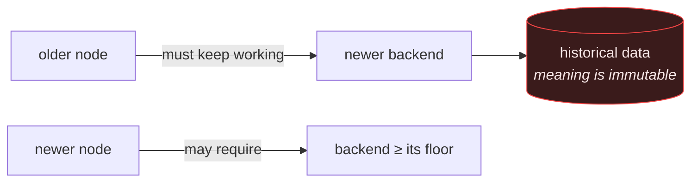

# Versioning

The platform is one repository containing **four components that are released
independently**, because they are deployed independently: you can update the
frontend without touching a node, and you can update a node without touching the
server.

---

## Components

| Component | Version source | Deployed to | Released by |
|---|---|---|---|
| **Platform** | git tag `vX.Y.Z` | the repository as a whole | GitHub release |
| **Backend** | `app.version` in `app/main.py` | application server | reload |
| **Edge / smart plugs** | [`edge/VERSION`](../edge/VERSION) — currently **1.2.0** | each Raspberry Pi | per-node install |
| **Monitoring** | stated in [`monitoring/README.md`](../monitoring/README.md) — currently **1.1.0** | application server | scheduler restart |

A platform release records which component versions it contains. A component
version bump does not require a platform release, but a platform release must
not silently contain an unbumped component change.

---

## Semantic versioning

`MAJOR.MINOR.PATCH`, applied to what a *consumer* of each component observes.

### What counts as MAJOR

| Component | Breaking change means |
|---|---|
| Platform | A release that cannot be applied without an operator procedure — a migration that is not reversible, a config format change, a node that must be updated in lockstep |
| Backend | A removed or incompatibly changed API route; a change to the ingestion contract |
| Edge | A change requiring a backend newer than the previous release |
| Monitoring | A change to the alerting contract — a rule that now pages when it used to be report-only |

> [!IMPORTANT]
> **The measurement contract is the most consequential compatibility surface in
> this system.** The fields in
> [`backend/docs/collector-contract.md`](../backend/docs/collector-contract.md)
> are marked *"fixed forever"* deliberately. Changing the meaning of
> `interval_energy_kwh`, `interval_seconds` or `energy_source` invalidates
> historical data that has already been stored under the old meaning — and
> historical data cannot be re-collected.
>
> This is why `measurement_eras` exists: the platform resolves what a legacy
> field *meant at the time it was written* rather than pretending the meaning
> never changed. Prefer a new era over a redefinition.

### MINOR

New routes, new rules, new screens, new optional payload fields. Additive and
backwards-compatible: an older node must keep working against a newer backend.

### PATCH

Bug fixes, threshold tuning, documentation, dependency bumps.

> [!NOTE]
> **Threshold tuning is a patch, but it is never trivial.** Any change to
> alerting thresholds must be accompanied by the sensitivity checks
> (`tests/test_monitoring.py` sections 19–25 and
> `tests/test_synthetic_deployment.py`) proving that real faults still fire.
> See [Monitoring.md](Monitoring.md).

---

## Compatibility guarantees



| Direction | Guarantee |
|---|---|
| Older node → newer backend | **Supported.** Nodes are updated one at a time and a fleet is never uniform. `energy_kwh` is still accepted from legacy collectors for exactly this reason. |
| Newer node → older backend | Not guaranteed. Update the backend first. |
| Historical data | **Immutable in meaning.** Resolved through `measurement_eras`, never reinterpreted in place. |

The asymmetry is deliberate: the backend is one host you control, and the nodes
are physical devices in buildings you may not be able to visit today.

---

## Migrations and versions

Schema migrations are numbered independently (`001`–`012`) and tracked in
`schema_migrations`. A platform release states the migration range it contains.

Every migration ships a `.down.sql` (or a reversing `.py`). A migration that
cannot be reversed makes its release **MAJOR**, and that is a strong reason to
find a reversible design instead.

See [Database.md § Migrations](Database.md#migrations).

---

## Releasing

```bash
# 1. Update CHANGELOG.md — move Unreleased into a dated version
# 2. Bump the component version(s) that changed
# 3. Tag
git tag -a v1.0.0 -m "v1.0.0"
git push origin v1.0.0
```

The tag triggers the release workflow. Release notes are drafted from the
changelog rather than from the commit log, because a commit log is a record of
work and release notes are a description of change — they are not the same
document.

### Release checklist

- [ ] `CHANGELOG.md` updated, `Unreleased` emptied
- [ ] Component versions bumped where they changed
- [ ] All six backend suites pass
- [ ] Sensitivity checks pass if any threshold moved
- [ ] Every migration in the release has a working `.down`
- [ ] Breaking changes listed explicitly, with the operator procedure
- [ ] Documentation updated in the same release, not after it

---

## History

The repository's git history begins on **2026-06-14**, with the frontend's 59
commits carried in under their original authorship and dates. Backend, edge and
monitoring work from the same period predates central version control and enters
the history as its first tracked state — the commit messages say so rather than
implying the code was written the day it was committed.

See [Changelog.md](Changelog.md).
