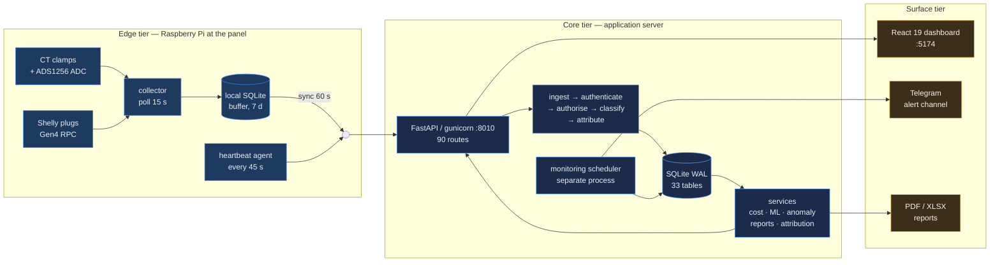
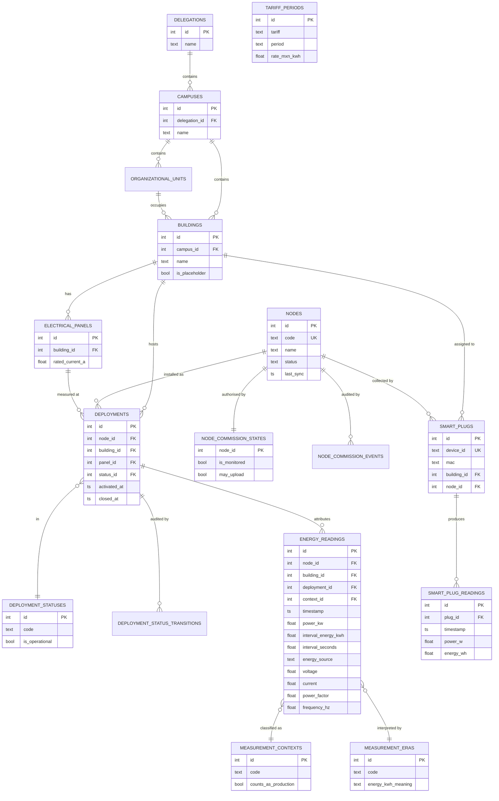
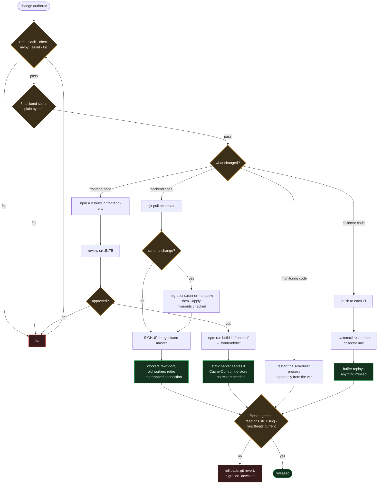
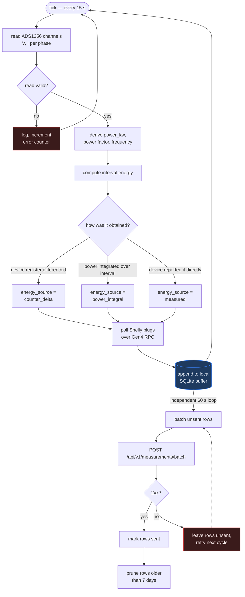
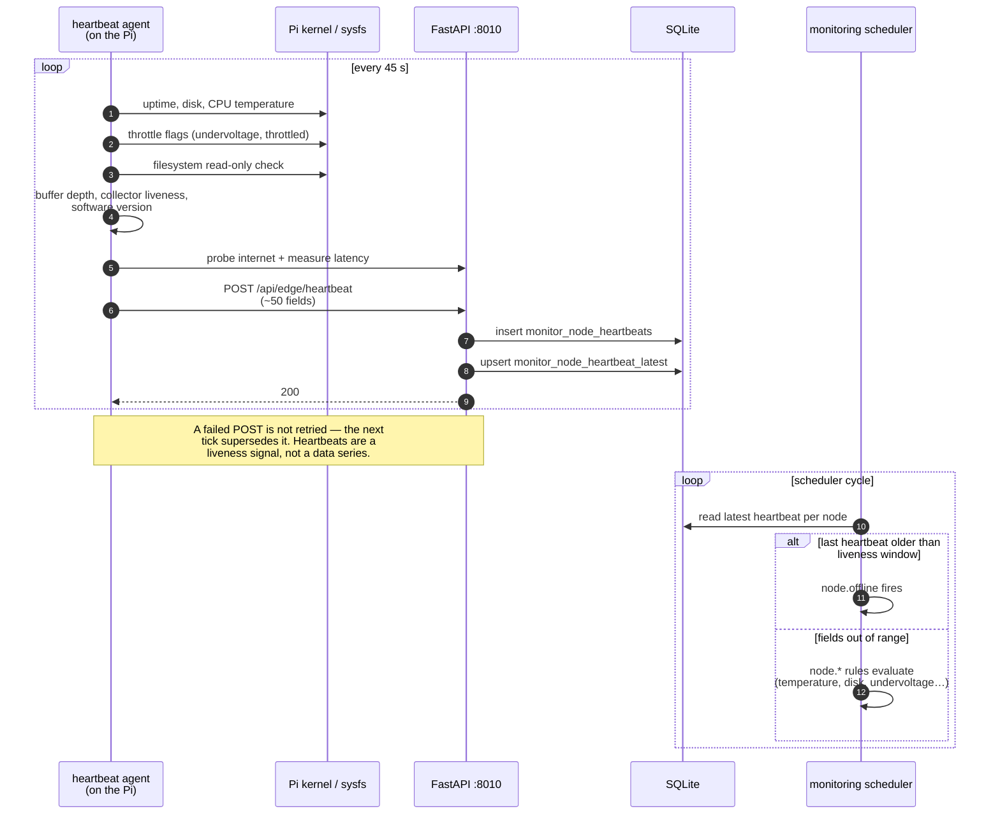
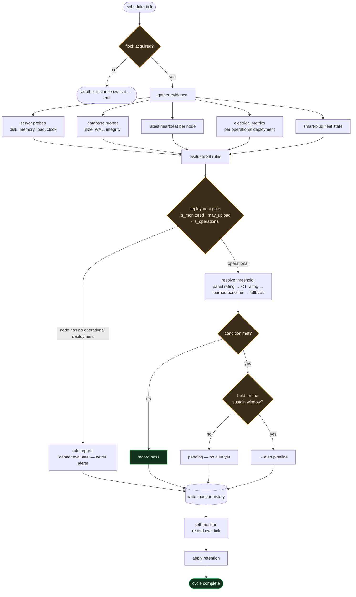
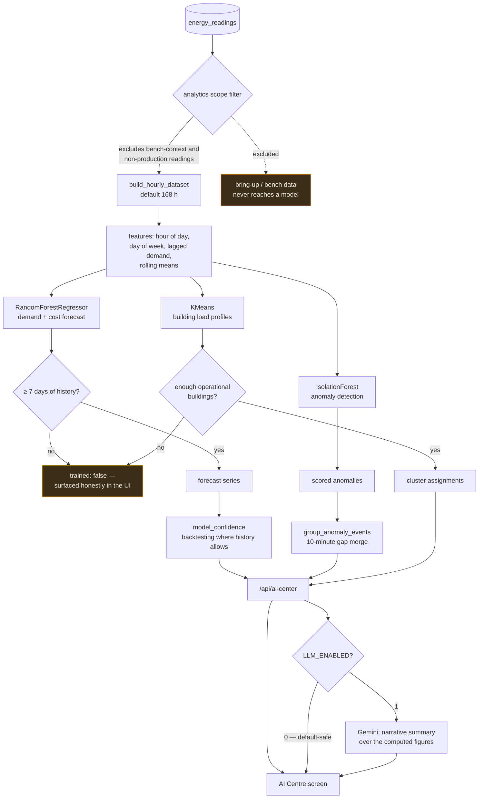
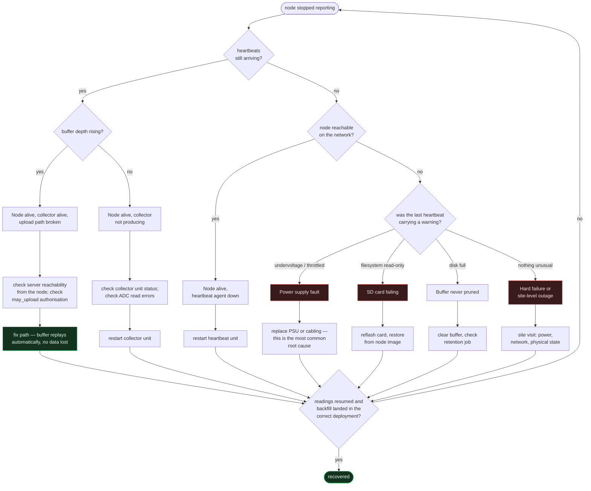
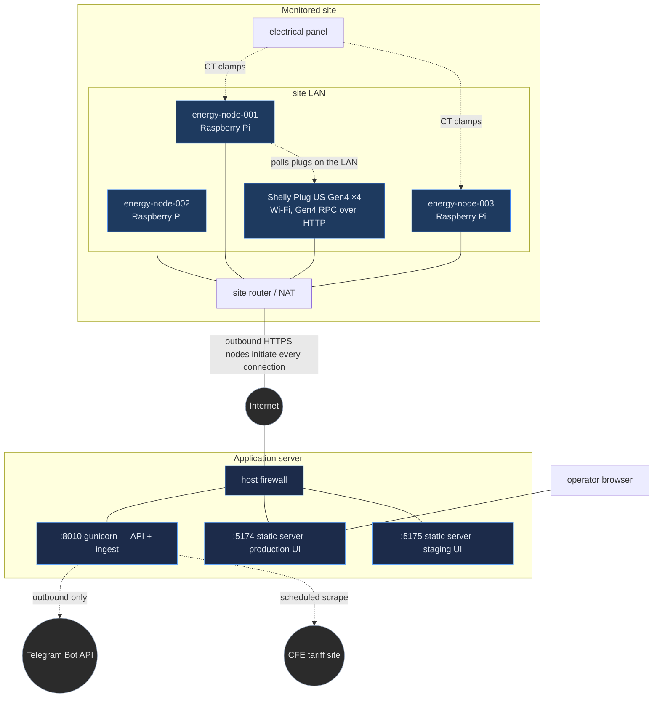

# Diagrams

Every structural diagram for the platform, in one place. All of them are
Mermaid, so GitHub renders them inline and they diff as text when the system
changes — there are no binary images to fall out of date silently.

Each diagram is also embedded in the document that owns the subject. This page
is the index.

| # | Diagram | Owning document |
|---|---|---|
| 1 | [System architecture](#1-system-architecture) | [Architecture.md](../Architecture.md) |
| 2 | [Database](#2-database) | [Database.md](../Database.md) |
| 3 | [Deployment flow](#3-deployment-flow) | [Deployment.md](../Deployment.md) |
| 4 | [Collector flow](#4-collector-flow) | [Collector.md](../Collector.md) |
| 5 | [Heartbeat flow](#5-heartbeat-flow) | [Monitoring.md](../Monitoring.md) |
| 6 | [Monitoring pipeline](#6-monitoring-pipeline) | [Monitoring.md](../Monitoring.md) |
| 7 | [Alert pipeline](#7-alert-pipeline) | [Monitoring.md](../Monitoring.md) |
| 8 | [AI pipeline](#8-ai-pipeline) | [AI.md](../AI.md) |
| 9 | [Boot process](#9-boot-process) | [Deployment.md](../Deployment.md) |
| 10 | [Node recovery](#10-node-recovery) | [Recovery.md](../Recovery.md) |
| 11 | [Data synchronisation](#11-data-synchronisation) | [Collector.md](../Collector.md) |
| 12 | [Network topology](#12-network-topology) | [Networking.md](../Networking.md) |

---

## 1. System architecture

Three tiers: measurement at the edge, storage and interpretation at the centre,
presentation and alerting at the surface. The monitoring scheduler is drawn
outside the API process because that separation is deliberate — see
[Architecture.md](../Architecture.md).



---

## 2. Database

The domain schema. Monitoring owns six further tables in its own namespace
(`monitor_*`) and deliberately modifies none of these; migration shadow tables
(`*_pre_m*`) are omitted.

The structural point is that **identity, authorisation, lifecycle and
attribution are four separate concerns** with four separate owners. See
[ADR-0001](../../backend/docs/adr/0001-separate-identity-health-lifecycle-attribution.md).



---

## 3. Deployment flow

How a code change reaches production. There is no container runtime and no
orchestrator: this is systemd, gunicorn and a static build, and the flow is
written to match what actually happens rather than an idealised pipeline.



---

## 4. Collector flow

One sampling cycle on a node. The important property is that **nothing in this
loop can lose a measurement because the network is down** — the buffer is
written before the upload is ever attempted.



---

## 5. Heartbeat flow

Health reporting travels on its own path, on its own schedule. That is what
makes "the node is down" distinguishable from "the node is up but not
measuring" — the two failures produce different evidence.



---

## 6. Monitoring pipeline

One scheduler cycle. 39 rules across nine subsystems, each returning a verdict
plus the evidence behind it.



> [!IMPORTANT]
> The deployment gate is the single most important box on this diagram. The
> first production run sent **1,386 Telegram messages in four days**, and 1,288
> of them came from nodes with no operational deployment. See
> [Monitoring.md § Alerting policy](../Monitoring.md#alerting-policy).

---

## 7. Alert pipeline

What happens between "a rule fired" and "a human is interrupted" — and, most of
the time, what stops the interruption from happening.

```mermaid
stateDiagram-v2
  direction LR
  [*] --> Evaluating

  Evaluating --> Pending: condition true
  Pending --> Evaluating: cleared before<br/>sustain window elapsed
  Pending --> Firing: held for the<br/>full sustain window

  Firing --> Deduplicated: an identical alert<br/>is already open
  Deduplicated --> Firing: same alert,<br/>occurrence counted

  Firing --> Routed
  state Routed {
    direction LR
    [*] --> Severity
    Severity --> ReportOnly: INFO / WARNING
    Severity --> Paging: CRITICAL / EMERGENCY
    ReportOnly --> [*]: appears in the hourly<br/>report only
    Paging --> [*]: queued to the outbox
  }

  Routed --> Outbox: paging alerts only
  Outbox --> Delivered: Telegram accepted
  Outbox --> Outbox: delivery failed —<br/>retained and retried
  Delivered --> Open

  Open --> Escalated: still true after<br/>the escalation window
  Escalated --> Open

  Open --> Resolving: condition absent
  Resolving --> Open: reappeared inside<br/>the hysteresis window
  Resolving --> Resolved: absent for the<br/>full hysteresis window
  Resolved --> [*]

  note right of Outbox
    The outbox never discards a message.
    A Telegram outage delays delivery;
    it does not lose the alert.
  end note

  note right of Resolving
    Hysteresis exists because a value
    oscillating on a threshold would
    otherwise send two messages per
    crossing, forever.
  end note
```



---

## 8. AI pipeline

Three scikit-learn models plus an optional LLM narration layer. Everything
numeric is computed locally; the LLM only writes prose about numbers it is
given, and the platform is fully functional with `LLM_ENABLED=0`.



> [!NOTE]
> The scope filter is not a refinement. Building profiles trained on bench data
> were the worst single source of wrong analytics in this platform's history —
> see [ADR-0006](../../backend/docs/adr/0006-legacy-deployment-dates-non-authoritative.md)
> and [AI.md § Data scope](../AI.md#data-scope).

---

## 9. Boot process

What comes up, in what order, on both tiers. Nothing here waits on anything
else across the network — a node boots and starts buffering whether or not the
server exists, and vice versa.

```mermaid
sequenceDiagram
  autonumber
  participant SD as systemd (server)
  participant GU as gunicorn master
  participant WK as uvicorn worker
  participant DB as SQLite (WAL)
  participant MS as monitoring scheduler
  participant FS as static server
  participant PI as systemd (Raspberry Pi)

  rect rgba(59,130,246,0.10)
    Note over SD,FS: Application server
    SD->>GU: start energy-platform-backend.service
    GU->>WK: fork worker (-w 1)
    WK->>WK: load .env via python-dotenv
    WK->>WK: import routers, register 90 routes
    WK->>WK: import monitoring package<br/>(registers 39 rules; creates no tables)
    WK->>DB: open connection, WAL mode
    WK-->>GU: ready — /health serves 200
    SD->>FS: start energy-platform-frontend.service
    FS->>FS: serve frontend/dist, Cache-Control: no-store
    SD->>MS: start energy-platform-monitoring.service
    MS->>MS: flock — refuse to start a second instance
    MS->>DB: create monitor_* tables if absent
    MS->>MS: begin scheduler loop, record own liveness
  end

  rect rgba(245,158,11,0.10)
    Note over PI: Edge node — independent of the above
    PI->>PI: start collector unit
    PI->>PI: open local SQLite buffer
    PI->>PI: begin 15 s sample loop
    PI->>PI: begin 60 s sync loop (retries if server absent)
    PI->>PI: start heartbeat unit, 45 s loop
  end
```

---

## 10. Node recovery

The decision tree an operator follows when a node stops reporting. It is
ordered by what the evidence can distinguish, not by what is easiest to check.



---

## 11. Data synchronisation

The reconciliation between a node's buffer and the central store, including the
case that makes it non-trivial: a long outage whose backfill spans a deployment
change.

```mermaid
sequenceDiagram
  autonumber
  participant COL as collector
  participant BUF as local buffer
  participant API as /api/v1/measurements/batch
  participant ATT as attribution
  participant DB as energy_readings

  Note over COL,BUF: Normal operation
  COL->>BUF: append sample (captured_at = now)
  loop every 60 s
    BUF->>API: batch of unsent rows
    API->>API: authenticate node
    API->>API: authorise — may_upload?
    API->>ATT: classify + attribute each row
    ATT->>ATT: resolve deployment by the row's<br/>own captured_at, not by newest id
    ATT->>DB: insert with building_id,<br/>deployment_id, context_id
    API-->>BUF: 200 — mark rows sent
  end

  Note over COL,DB: Outage and replay
  COL->>BUF: append (server unreachable)
  BUF->>BUF: rows accumulate — up to 7 days
  BUF--xAPI: sync fails, rows stay unsent
  Note right of BUF: Backpressure is the only<br/>symptom; no sample is dropped.

  BUF->>API: server returns — replay backlog
  API->>ATT: rows carry their original captured_at
  alt backfill spans a deployment change
    ATT->>ATT: earlier rows → the deployment<br/>that was active when captured
    ATT->>ATT: later rows → the current deployment
  end
  ATT->>DB: each row attributed to its own moment
  API-->>BUF: 200 — prune beyond retention
```

> [!WARNING]
> Attributing a whole batch to the newest deployment id — rather than to each
> row's own `captured_at` — silently and permanently files buffered data against
> the wrong building. This was a real defect, found in the 2026-07-26 audit, and
> is the reason [ADR-0004](../../backend/docs/adr/0004-immutable-timestamp-attribution.md)
> exists.

---

## 12. Network topology

How the tiers actually reach each other. Node access is over the site's public
NAT address rather than the overlay network, which matters when you are trying
to reach one at 3 a.m.



> [!NOTE]
> Every connection is initiated **outbound from the node**. No inbound port is
> forwarded to a Pi for the platform's own operation, so a node behind an
> ordinary consumer NAT needs no network configuration to work. Operator SSH
> access is a separate concern — see [Networking.md](../Networking.md).
